# AGC 1 – Memoria y E/S (Laboratorio 6)

**Caso guía.** En 1969 el AGC del módulo lunar tenía 2048 palabras de memoria borrable (RAM de núcleos magnéticos) y 36 864 palabras de memoria fija (rope memory). Los astronautas no tenían pantalla gráfica: consultaban direcciones de memoria tecleando un **Verbo** (qué hacer) y un **Sustantivo** (sobre qué dato). En este laboratorio se construye una versión simplificada de esa máquina en un ESP32. Hoy: la memoria y la forma de asomarse a ella.

**Ancla de sesión (Wokwi):** `ANCLA C40A24-Oct 15 2026-00:11:19-15894`

**Objetivos cumplidos:**

- Definir un mapa de memoria sin traslapes con regiones RAM, E/S y ROM.
- Depositar el estado de cuatro botones en el registro de E/S `IO_BOTONES`.
- Mostrar el contenido de direcciones de memoria con los verbos 01 y 06 y los sustantivos 01 y 60.
- Distinguir memoria de registro de E/S con evidencia del propio montaje simulado.

## Funciona

### Paso 1: Hardware y simulador

Todo se montó en Wokwi con la opción B (resistencias pull-up internas). El OLED y el MPU6050 comparten el bus I2C, y los cuatro botones van del GPIO a GND, sin resistencias externas.

| Componente | Señal | Pin ESP32 |
|---|---|---|
| OLED SSD1306 | SDA / SCL | GPIO 21 / GPIO 22 |
| MPU6050 | SDA / SCL | GPIO 21 / GPIO 22 |
| Botón CAMPO | bit0 de `IO_BOTONES` | GPIO 25 (`INPUT_PULLUP`) |
| Botón MAS | bit1 | GPIO 26 (`INPUT_PULLUP`) |
| Botón MENOS | bit2 | GPIO 27 (`INPUT_PULLUP`) |
| Botón ENTR | bit3 | GPIO 32 (`INPUT_PULLUP`) |

Se abrió Wokwi.com y se montó el circuito:

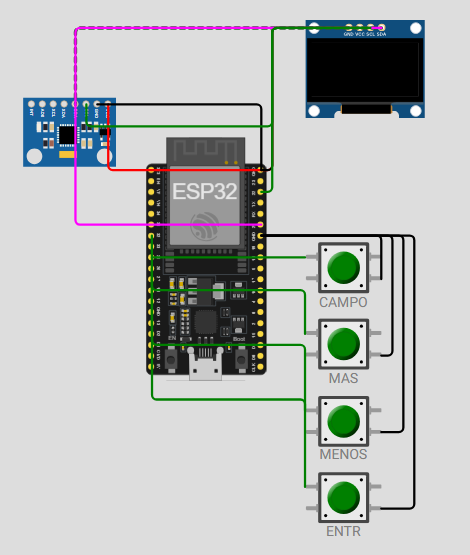

### Paso 2: Ancla de sesión

El ancla obtenida en Wokwi es `ANCLA C40A24-Oct 15 2026-00:11:19-15894`. El MAC simulado `C40A24` se repitió en todas las ejecuciones; la sal cambió en cada arranque y la fecha/hora cambió con cada compilación. Las evidencias provienen de tres compilaciones del mismo proyecto (23:30:52, 23:58:04 y 00:11:19).

### Paso 3: Escáner I2C

El escáner recorrió las direcciones 1 a 127 y encontró dos dispositivos:

| Dirección | Dispositivo |
|---|---|
| 0x3C | OLED SSD1306 |
| 0x68 | MPU6050 (AD0 a GND) |

Monitor serial al arranque: ancla, escáner I2C, direcciones físicas y pruebas del mapa de memoria:

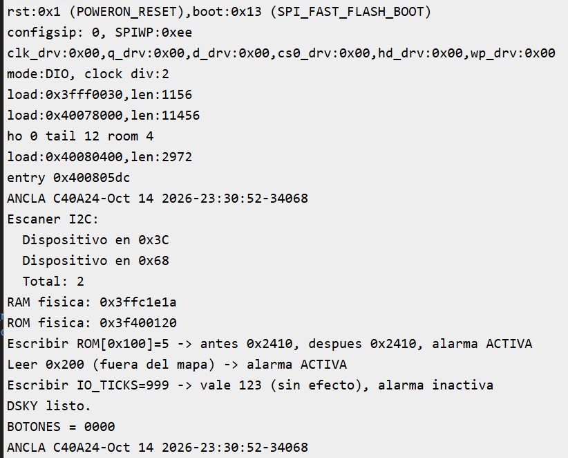

### Paso 4: Mapa de memoria

La RAM ocupa 64 palabras desde 0x000, así que la E/S inicia inmediatamente después, en 0x040. El archivo `agc_mem.h` incluye directivas `#error` que impiden compilar si las regiones se traslapan.

| Región | Inicio | Fin | Tamaño | Acceso |
|---|---|---|---|---|
| RAM | 0x000 | 0x03F | 64 palabras | Lectura y escritura |
| E/S | 0x040 | 0x04F | 16 registros | Lectura y escritura, salvo `IO_TICKS` (solo lectura) |
| ROM | 0x100 | 0x13F | 64 palabras | Solo lectura |

La matrícula 241050161 se guardó en las tres primeras palabras de la ROM, cuatro dígitos por palabra: 0x2410, 0x5016 y 0x0001. Los valores de ejemplo del enunciado (0x1234, 0x0007, 0xFFFE) quedaron en `ROM[3..5]`.

### Paso 5: Alimentar la E/S desde los botones

Cada 20 ms el `loop()` actualiza `IO_BOTONES`, `IO_JOY_SW` e `IO_TICKS`.

### Paso 6: DSKY mínimo

| Verbo | Significado |
|---|---|
| 01 | Palabra en octal (6 dígitos) |
| 06 | Palabra en decimal con signo (5 dígitos) |

| Sustantivo | R1 | R2 | R3 |
|---|---|---|---|
| 01 | contenido de la dirección en `RAM[0]` | contenido de la dirección en `RAM[1]` | contenido de la dirección en `RAM[2]` |
| 60 | `IO_BOTONES` en octal | `IO_JOY_SW` | `IO_TICKS` |

El OLED muestra en la primera línea el verbo y el sustantivo que se están tecleando, tres registros R1–R3 y una línea USO con los que están aplicados. La última línea muestra el ancla corta.

### Paso 7: Teclear sin teclado

- **CAMPO** avanza el cursor por las decenas y unidades del verbo y del sustantivo; el dígito activo se muestra invertido.
- **MAS / MENOS** incrementan o decrementan el dígito activo de 0 a 9 con envolvente.
- **ENTR** aplica verbo y sustantivo. Una combinación no implementada muestra `OPR`, imprime `OPR ERR` y conserva la anterior.

Toda la lógica lee únicamente `IOREG[IO_BOTONES]`. Un estado se acepta cuando se repite en dos muestras consecutivas (20 ms) y la acción ocurre solo en el flanco de subida, por lo que mantener un botón presionado no repite el dígito.

## Midió

### Pruebas del mapa de memoria (al arranque)

| Prueba | Resultado | Alarma |
|---|---|---|
| `escribirMem(0x100, 5)` | ROM[0] antes 0x2410, después 0x2410 | ACTIVA |
| `leerMem(0x200)`, fuera del mapa | devuelve 0 | ACTIVA |
| `escribirMem(IO_TICKS, 999)` | conserva 123 (sin efecto) | inactiva |

Direcciones físicas de los arreglos: **RAM = 0x3FFC1E1A** y **ROM = 0x3F400120**.

### Valores de `IO_BOTONES`

| Botones presionados | `IO_BOTONES` |
|---|---|
| Ninguno | 0000 |
| CAMPO | 0001 |
| MAS | 0010 |
| MENOS | 0100 |
| ENTR | 1000 |
| CAMPO + MAS | 0011 |

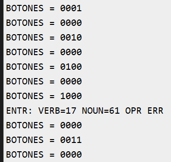

### Pin flotante: ¿basta con `INPUT`?

Se puso a prueba la afirmación *"No hace falta `INPUT_PULLUP`; con `INPUT` el pin al aire lee LOW."* **Se refuta.** Con los cuatro pines en `INPUT` y los botones sueltos se tomaron 20 lecturas en dos arranques distintos:

| Arranque | Lectura (20 de 20) | Pin flotante en BAJO |
|---|---|---|
| 1 | 1000 | GPIO 32 (ENTR) |
| 2 | 0010 | GPIO 26 (MAS) |

Tres de los cuatro pines leyeron ALTO, no LOW, y el pin que quedó en BAJO cambió de un arranque a otro. Sin pull-up, el DSKY habría visto un botón presionado sin que nadie lo tocara. En una placa física el efecto sería peor, porque además el ruido haría variar la lectura entre muestras. Después de la prueba se regresó a `INPUT_PULLUP`.

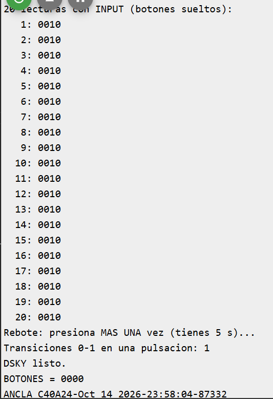

### Rebote del botón

Se muestreó el bit de MAS cada 1 ms durante una pulsación. En una ejecución se contaron 2 transiciones 0→1 en una sola pulsación y en otras 1: el contacto rebotó una vez antes de estabilizarse, en un lapso de pocos milisegundos. Sin antirrebote, esa pulsación habría incrementado el dígito dos veces. La medición se hizo en simulación; un botón físico suele rebotar durante 1–10 ms.

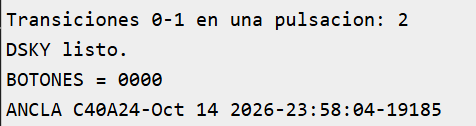

### Pruebas del DSKY con `V06 N60`

Con `V06 N60`, al presionar cada botón R1 muestra su bit en octal y R2 cae a 0 con ENTR:

| Botón presionado | R1 | R2 | R3 |
|---|---|---|---|
| Ninguno | 000000 | +00001 | ticks en aumento |
| MAS | 000002 | +00001 | ticks en aumento |
| ENTR | 000010 | +00000 | ticks en aumento |

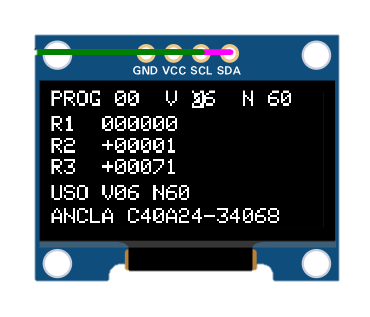

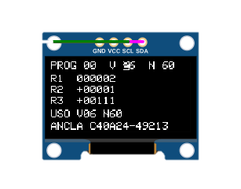

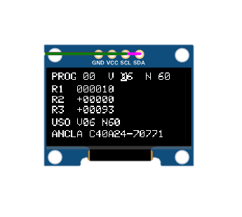

### Prueba de `V01 N01`

Con `RAM[0] = 0x100`, `RAM[1] = 0x101` y `RAM[2] = 0x102`, el DSKY muestra el contenido de la ROM donde está guardada la matrícula:

| Registro | Dirección | Valor hexadecimal | Mostrado en octal |
|---|---|---|---|
| R1 | 0x100 | 0x2410 | 022020 |
| R2 | 0x101 | 0x5016 | 050026 |
| R3 | 0x102 | 0x0001 | 000001 |

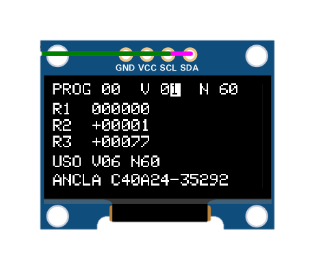

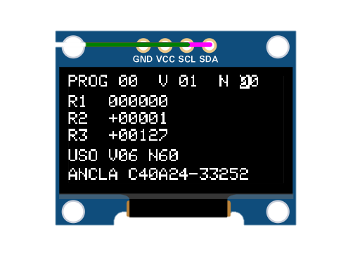

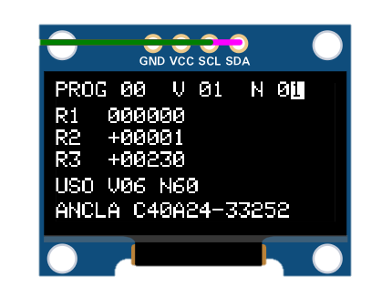

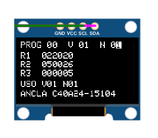

### Pulsación sostenida

Con el cursor en la decena del verbo se mantuvo MAS durante 3 s. El serial registró una sola transición (0000 → 0010 → 0000) y el verbo pasó de 06 a 16 sin repetir el incremento.

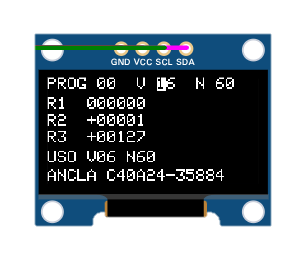

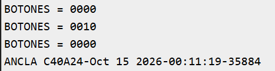

### Comando inválido

Al teclear `V21 N02` y presionar ENTR, el OLED mostró `OPR` y se conservó `V01 N01`.

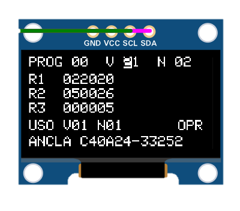

## Argumentó

### Investigación previa

**1. ¿Qué es memoria mapeada a E/S y en qué se diferencia de E/S por puertos?**
En la E/S mapeada a memoria, los registros de los periféricos ocupan direcciones del mismo espacio que la memoria y se accede a ellos con las mismas instrucciones de carga y almacenamiento; en la E/S por puertos existe un espacio de direcciones aparte con instrucciones especiales (Espressif Systems, s.f.-b).

**2. ¿Cuántos bits tenía una palabra del AGC y por qué usaba complemento a uno en lugar de complemento a dos?**
La palabra del AGC era de 16 bits: 15 de dato y 1 de paridad. Usaba complemento a uno porque negar un número consiste solo en invertir sus bits y la suma se resuelve con un sumador simple con acarreo circular, lo que simplificaba el hardware a cambio de tener dos ceros, +0 y −0 (Burkey, s.f.).

**3. ¿Opción A u opción B? (pull-up)**
Opción B: una resistencia pull-up es una resistencia conectada a VCC que fija un pin en nivel ALTO mientras nada lo jale a GND. La interna del ESP32 es de aproximadamente 45 kΩ. Un GPIO configurado como `INPUT` sin conexión queda flotante y lee valores indeterminados, no un 0 confiable (Espressif Systems, s.f.-a).

### ¿Por qué el MAC de Wokwi es igual para todos y cuál ancla es más difícil de falsificar?

Wokwi simula un eFuse con un valor fijo, idéntico para cualquier usuario, por lo que ese MAC no identifica a nadie. En una placa física el MAC viene grabado de fábrica y es único por chip, así que el ancla física es más difícil de falsificar: solo puede reproducirse con esa placa. En simulación, lo único que identifica la sesión son la fecha/hora de compilación y la sal aleatoria.

### ¿Qué pasaría si AD0 se conectara a 3.3 V y por qué existe ese pin?

El MPU6050 cambiaría de 0x68 a 0x69 y el escáner lo mostraría en esa dirección. El pin AD0 existe para poder conectar dos MPU6050 en el mismo bus I2C sin que choquen sus direcciones.

### ¿Cuál dirección está en flash mapeada y cuál en SRAM interna?

Según el mapa de memoria del ESP32, 0x3F400120 cae en el rango 0x3F40_0000–0x3F7F_FFFF, que corresponde a la flash externa mapeada vía caché en el bus de datos; ahí quedó el arreglo `const` ROM. La dirección 0x3FFC1E1A cae en 0x3FFA_E000–0x3FFF_FFFF, la SRAM interna; ahí quedó el arreglo RAM. Coincide con lo esperado: la ROM vive en flash y la RAM en SRAM. Aun así, la flash mapeada puede leerse con cualquier puntero; quien hace cumplir que la ROM sea de solo lectura es la función `escribirMem`.

### ¿Cuántos dígitos octales necesita una palabra de 16 bits y qué se hace con el bit sobrante?

Se necesitan 6 dígitos: cinco cubren 15 bits y el sexto lleva el bit más significativo, por lo que el primer dígito solo puede valer 0 o 1. Se decidió mostrar los 6 dígitos completos, convirtiendo la palabra a `uint16_t` antes de imprimirla, para que un valor negativo como 0xFFFE aparezca como 177776 y no se extienda el signo.

### Rebote por hardware y ventaja de leer IOREG

El rebote se puede eliminar con una red RC: una resistencia de pull-up R hacia 3.3 V y un capacitor C del GPIO a GND, con el botón descargando el capacitor. La salida conviene pasarla por un Schmitt trigger, como el 74HC14, para que la subida lenta del capacitor no produzca cambios falsos. La constante de tiempo τ = R·C debe ser claramente mayor que la duración del rebote: con 2 transiciones medidas a 1 ms de muestreo, el rebote dura del orden de 1–2 ms, y un botón físico puede llegar a 10 ms, así que se elige R = 10 kΩ y C = 1 µF, que dan τ = 10 ms.

Leer IOREG en lugar de `digitalRead` desacopla la lógica del DSKY del hardware: el DSKY no sabe de dónde vienen los bits. Si en el Lab 2 cambia la fuente de entrada (interrupciones, otro periférico o un multiplexor), solo cambia el código que escribe `IO_BOTONES` y el resto queda igual. Es el mismo principio de la E/S mapeada a memoria.

### Conclusión

El mapa de memoria funcionó como frontera entre las regiones: la ROM no se modificó al intentar escribirla, los accesos fuera del mapa activaron la alarma y el registro `IO_TICKS` ignoró las escrituras. Las direcciones físicas confirmaron que el arreglo `const` quedó en flash mapeada y el arreglo de RAM en SRAM interna, aunque es `escribirMem` y no el hardware quien impide escribir en la ROM.

### Declaración del uso de la IA

Se utilizó soporte de la IA para la eliminación de errores en el código y el esquema del circuito, así como para la investigación de elementos que no logre comprender por mi cuenta.
