# AGC 2 – CPU e ISA (Laboratorio 7)

## Introducción y objetivo

En esta práctica se amplía el sistema AGC desarrollado en el laboratorio anterior. Se implementa una CPU sencilla capaz de leer instrucciones de la memoria, interpretarlas y ejecutarlas. También se integra el control de la CPU con el DSKY, se revisa el comportamiento de los registros y se prueba la protección ante un salto a una dirección inválida.

**Objetivo.** Implementar y comprobar el ciclo fetch-decode-execute de una CPU de 16 bits, utilizar un conjunto propio de instrucciones (ISA), ejecutar un programa de suma y verificar tanto el funcionamiento del DSKY como la detección de errores de memoria.

## Funciona

### Paso 1: Formato de instrucción

La palabra es de 16 bits: los 4 bits altos son el **opcode** y los 12 bajos la **dirección**. La función `codificar` arma la palabra con `op` desplazado 12 bits unido a `dir`, y `decodificar` separa ambos campos usando un entero sin signo para que el desplazamiento no extienda el signo.

| Opcode | Mnemónico | Operación | Modifica |
|---|---|---|---|
| 0 | `TC dir` | PC = dir; Q = PC anterior + 1 | PC, Q |
| 1 | `CA dir` | A = M[dir] | A |
| 2 | `CS dir` | A = -M[dir] | A |
| 3 | `AD dir` | A = A + M[dir] | A |
| 4 | `TS dir` | M[dir] = A | memoria |
| 5 | `XCH dir` | intercambia A y M[dir] | A, memoria |
| 6 | `BZF dir` | si A == 0 entonces PC = dir | PC |
| 7 | `HALT` | detiene la CPU | estado |

### Paso 2: Registro y ciclo

**Revisar el proyecto del laboratorio anterior y el mapa de memoria.** Primero se abre el proyecto existente y se identifican los archivos que ya controlan la memoria, la pantalla y los botones. Se conserva el mapa de memoria del AGC y se revisa el código que define la ROM y los datos utilizados por el DSKY. Esta revisión es importante para evitar reemplazar información que el laboratorio anterior ya utiliza.

Se reemplazó el archivo `agc_mem.h` por este nuevo código:

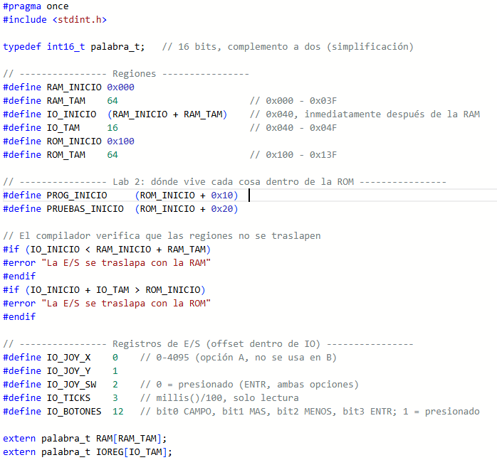

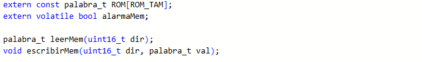

Se reemplazó el archivo `agc_mem.cpp` por este código:

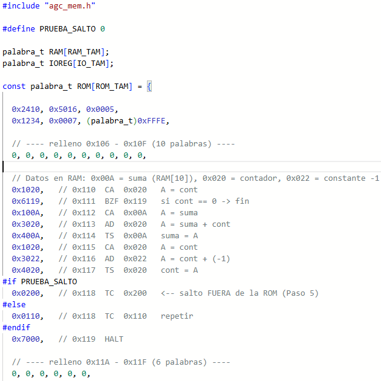

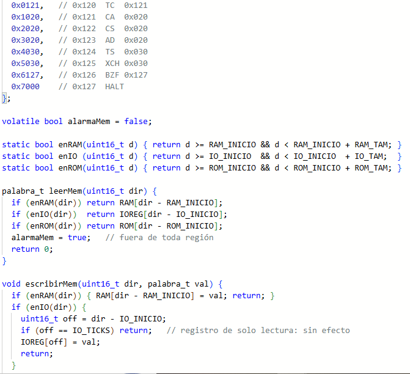

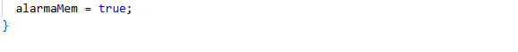

### Paso 3: Crear los archivos de la CPU

Se crean dos archivos nuevos: `agc_cpu.h`, para declarar la estructura de la CPU y sus funciones, y `agc_cpu.cpp`, para implementar la codificación, decodificación y ejecución de instrucciones. Separar la CPU de la memoria permite mantener el proyecto organizado y facilita comprobar cada parte.

Se agregó este código a `agc_cpu.h`:


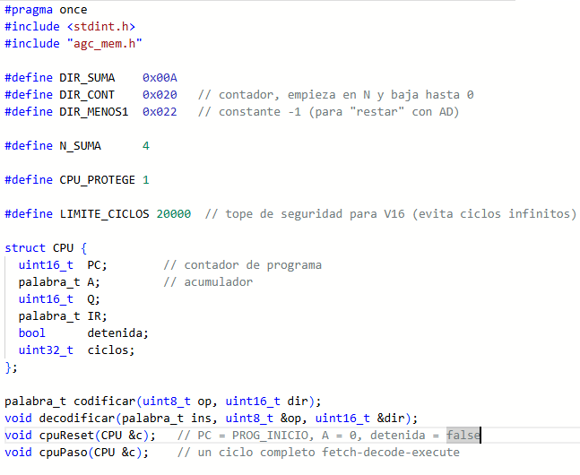

Se agregó este código a `agc_cpu.cpp`:


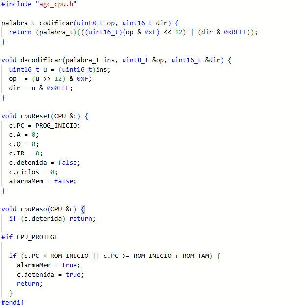

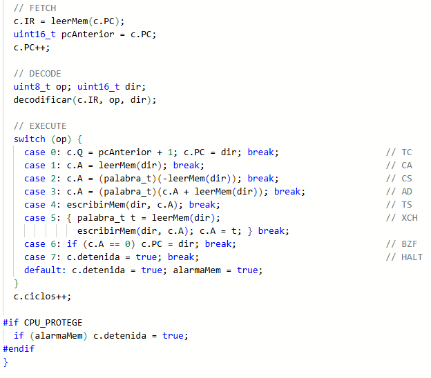

### Paso 4: Integrar la CPU con el sketch y el DSKY

Después se vinculan los archivos de la CPU con el sketch principal. El ciclo de ejecución debe realizar **FETCH** (leer la instrucción desde PC y guardarla en IR), **DECODE** (separar opcode y dirección) y **EXECUTE** (realizar la operación). Se mantienen los controles originales del DSKY y se añaden los verbos y sustantivos que permiten avanzar paso a paso, ejecutar hasta HALT, reiniciar y consultar registros.

Las instrucciones del ISA implementadas son: TC (transferencia de control), CA (cargar A), CS (cargar el negativo), AD (sumar), TS (guardar A), XCH (intercambiar A con memoria), BZF (salto si A es cero) y HALT (detener la CPU).

**Programa de suma de 1 a N (N = 4)**, cargado en la ROM a partir de 0x110. Los datos viven en RAM: 0x00A (suma, `RAM[10]`), 0x020 (contador) y 0x022 (constante −1).

| Dir | Hex | Ensamblador | Comentario |
|---|---|---|---|
| 0x110 | 0x1020 | `CA 0x020` | A = cont |
| 0x111 | 0x6119 | `BZF 0x119` | si cont = 0, ir a fin |
| 0x112 | 0x100A | `CA 0x00A` | A = suma |
| 0x113 | 0x3020 | `AD 0x020` | A = suma + cont |
| 0x114 | 0x400A | `TS 0x00A` | suma = A |
| 0x115 | 0x1020 | `CA 0x020` | A = cont |
| 0x116 | 0x3022 | `AD 0x022` | A = cont + (−1) |
| 0x117 | 0x4020 | `TS 0x020` | cont = A |
| 0x118 | 0x0110 | `TC 0x110` | repetir |
| 0x119 | 0x7000 | `HALT` | fin |

Se reemplazó `sketch.ino` por el siguiente código:

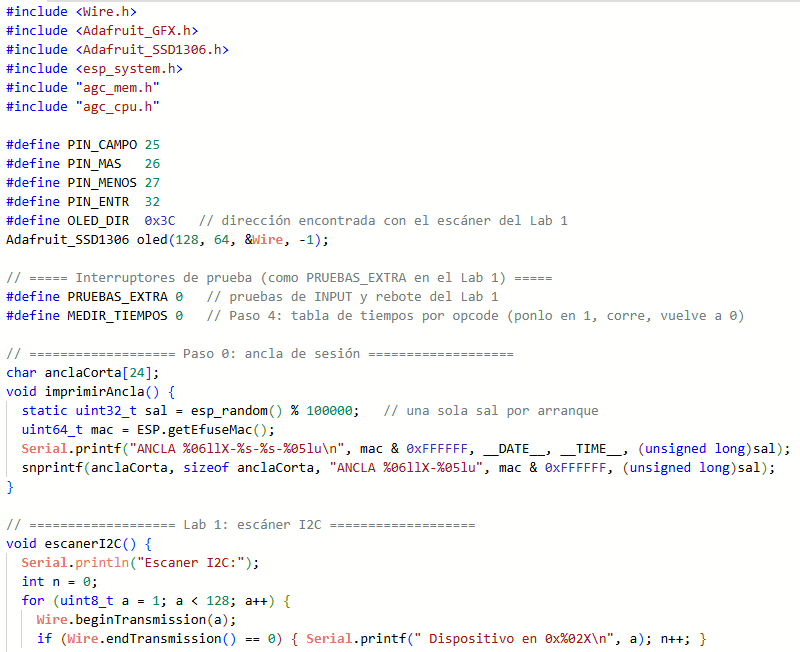

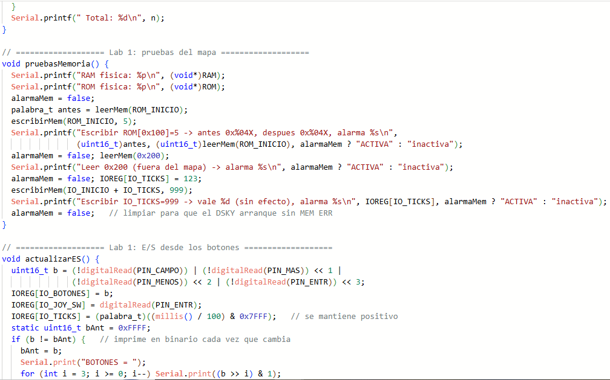

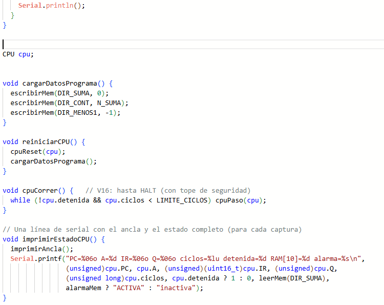

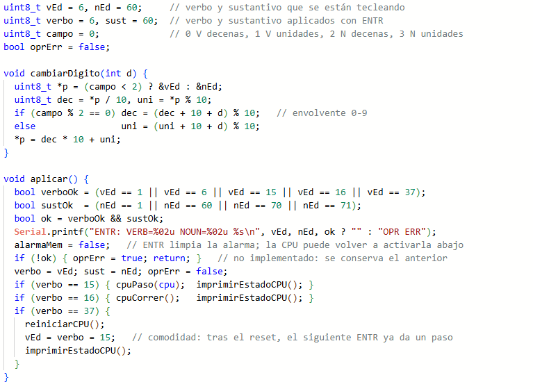

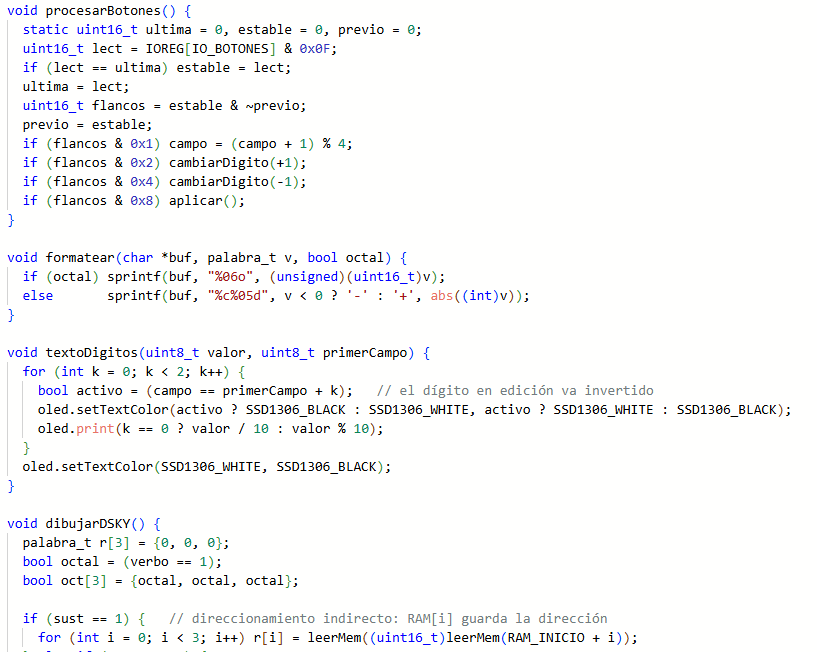

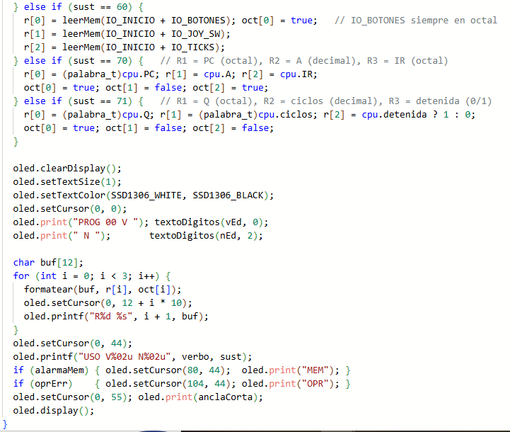

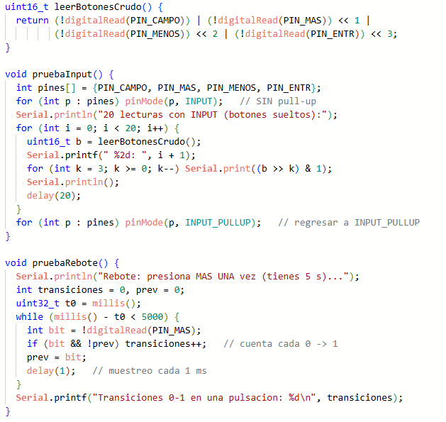

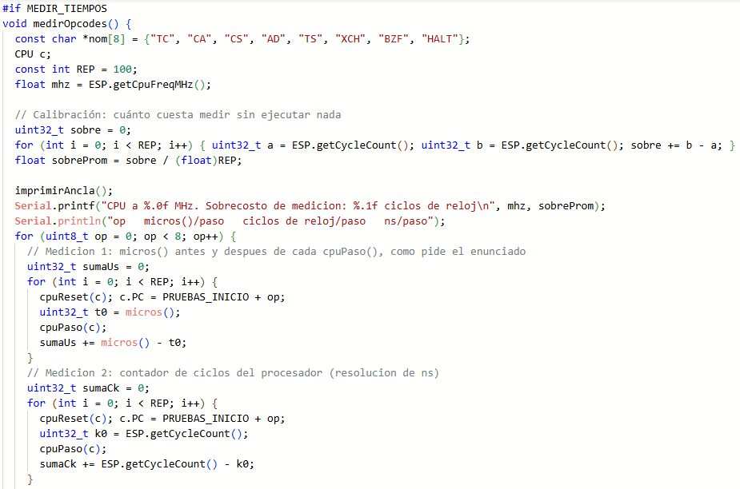

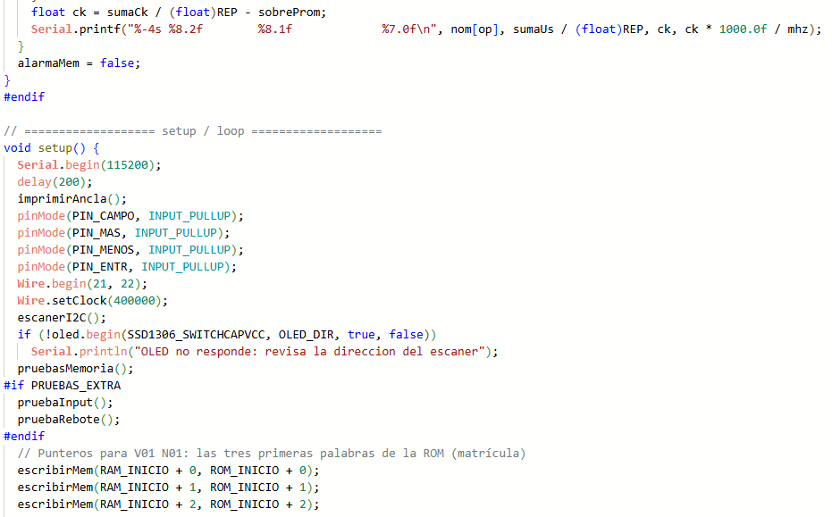

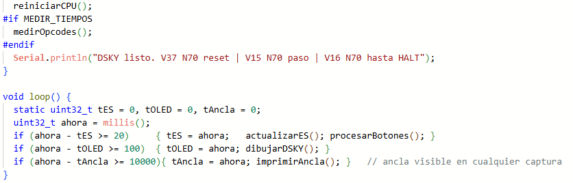

### Paso 5: Probar los comandos del DSKY y la ejecución

Con el programa cargado en el ESP32, se comprueba la comunicación entre el teclado DSKY y la CPU:

- `V15` ejecuta un solo paso de CPU.
- `V16` ejecuta instrucciones hasta llegar a HALT.
- `V37` reinicia la CPU.
- `N70` permite consultar PC, A e IR.
- `N71` muestra Q, el número de ciclos y el indicador de detención.

Las capturas siguientes registran la interacción con el sistema y la salida observada.

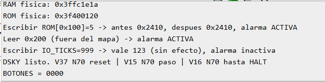

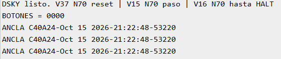

Reinicio de la CPU con `V37 N70`:

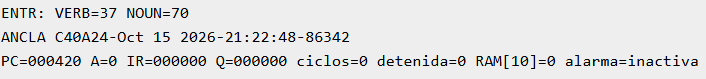

Ejecución paso a paso con `V15 N70` (ciclos 1 a 19):

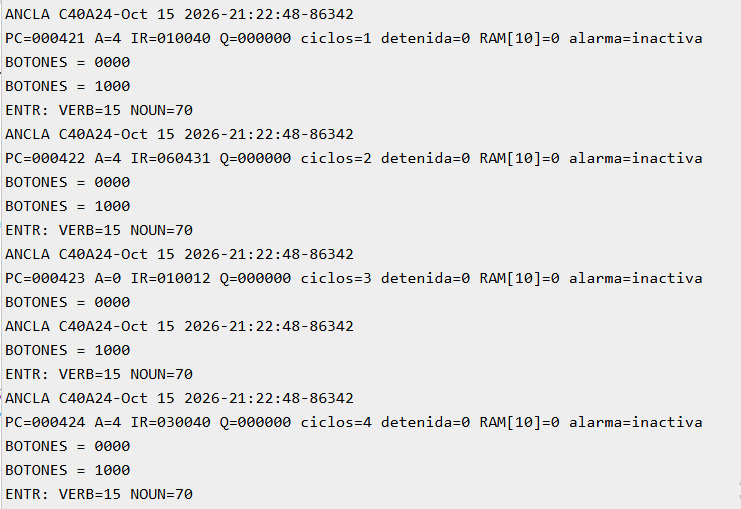

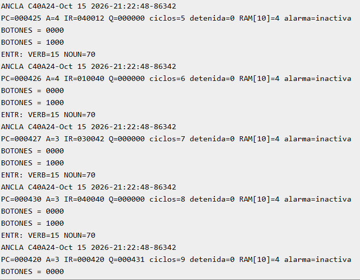

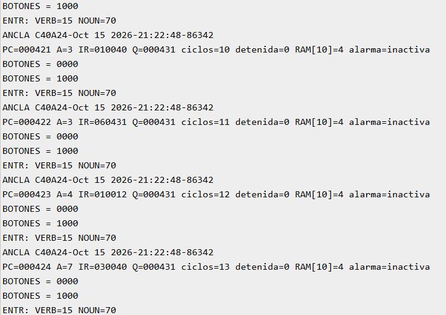

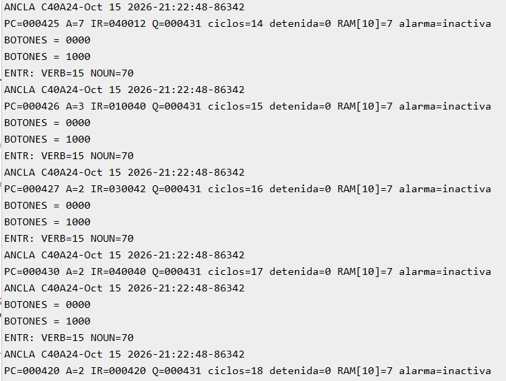

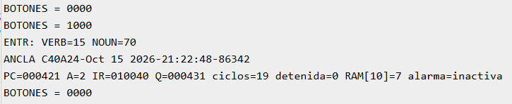

Ejecución hasta HALT con `V16 N70`: la CPU se detiene (`detenida=1`) con `RAM[10]=10` después de 39 ciclos.

![V16 N70: ciclos = 39, detenida = 1, RAM[10] = 10](../evidencias/lab7_29_v16_hasta_halt.png)

## Midió

### Verificación de la fórmula de ciclos = 9N + 3

Cada vuelta del programa ejecuta 9 instrucciones, y al final se agregan 3 de cierre (CA, BZF y HALT).

| N | RAM[10] | Ciclos medidos | 9N + 3 |
|---|---|---|---|
| 4 | 10 | 39 | 39 |
| 3 | 6 | 30 | 30 |

![Ejecución con N_SUMA = 3: ciclos = 30, RAM[10] = 6](../evidencias/lab7_32_n_suma_3.png)

### Paso 6: Tiempos de ejecución de las instrucciones

Para medir el tiempo se habilitó temporalmente la opción `MEDIR_TIEMPOS` y se utilizó `micros()` para tomar muestras de ejecución, con 100 repeticiones por cada uno de los ocho opcodes. Hay que considerar que `micros()` mide tiempo transcurrido en microsegundos y que las mediciones pueden variar por la carga del microcontrolador y la forma en que se toma la muestra.

En `sketch.ino` se cambió `MEDIR_TIEMPOS` a 1:

```cpp
#define MEDIR_TIEMPOS 1
```

Tiempo de ejecución por opcode (promedio de 100 repeticiones, CPU a 240 MHz; en las columnas de ciclos y ns ya se descontó el sobrecosto de medición de 30.0 ciclos de reloj):

| Opcode | micros()/paso | Ciclos de reloj/paso | ns/paso |
|---|---|---|---|
| TC | 10.69 | 1344.8 | 5603 |
| CA | 12.17 | 1629.0 | 6788 |
| CS | 11.41 | 1619.2 | 6747 |
| AD | 11.30 | 1626.5 | 6777 |
| TS | 11.29 | 1537.3 | 6405 |
| XCH | 13.20 | 2060.5 | 8586 |
| BZF | 10.70 | 1564.6 | 6519 |
| HALT | 10.86 | 1319.4 | 5498 |

La instrucción más lenta fue XCH (≈ 2060 ciclos, 8586 ns por paso) y las más rápidas fueron HALT (≈ 1319 ciclos) y TC (≈ 1345 ciclos).

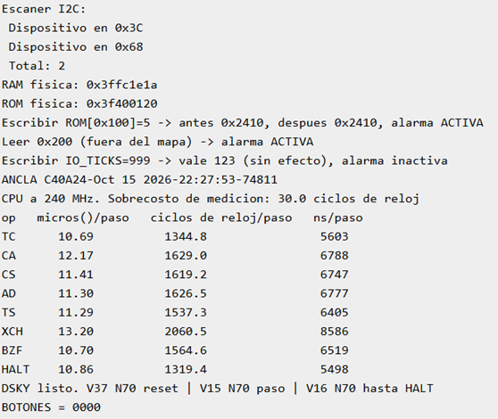

Después de tomar las mediciones se desactivó la opción de medición antes de la entrega:

```cpp
#define MEDIR_TIEMPOS 0
```

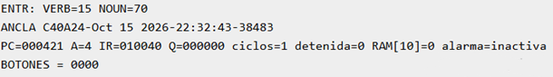

### Paso 7: Salto inválido y protección de memoria

La prueba de error fuerza un salto fuera de la ROM para comprobar si la CPU atiende la alarma de memoria. En la configuración sin protección (`CPU_PROTEGE 0`), la alarma puede activarse sin que la CPU se detenga y el programa continúa hasta alcanzar el límite de seguridad. Con la protección activada (`CPU_PROTEGE 1`), `cpuPaso` comprueba la condición de error y detiene la ejecución.

Cambios realizados para la prueba:

1. En `agc_cpu.h`, `N_SUMA` pasó de 4 a 3:

   ```cpp
   #define N_SUMA 3
   ```

2. En `agc_mem.cpp`, `PRUEBA_SALTO` pasó de 0 a 1:

   ```cpp
   #define PRUEBA_SALTO 1
   ```

3. En `agc_cpu.h`, `CPU_PROTEGE` pasó de 1 a 0 (sin protección):

   ```cpp
   #define CPU_PROTEGE 0
   ```

   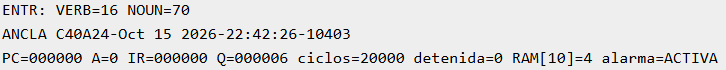

4. Se regresó `CPU_PROTEGE` a 1:

   ```cpp
   #define CPU_PROTEGE 1
   ```

   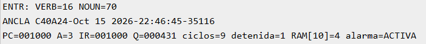

   ![Ejecución normal final: ciclos = 39, RAM[10] = 10](../evidencias/lab7_35_ejecucion_normal_final.png)

**Resultados de la prueba de protección:**

| Indicador | Antes: `CPU_PROTEGE 0` | Después: `CPU_PROTEGE 1` |
|---|---|---|
| Ciclos | 20 000 (tope de seguridad) | 9 |
| ¿Se detuvo? | No | Sí |
| Alarma | Activa, pero ignorada | Activa y atendida |

## Argumentó

### ¿Qué hace cada una de las tres fases fetch, decode y execute, y qué registro cambia en cada una?

**Fetch** trae la instrucción desde la memoria en PC, la guarda en IR e incrementa PC. **Decode** interpreta qué operación indica la instrucción, separando los 4 bits altos (opcode) de los 12 bajos (dirección). **Execute** realiza la operación matemática, lógica o de transferencia de datos.

### En el AGC, la instrucción TC guardaba algo en el registro Q. ¿Qué guardaba y para qué servía?

En el AGC, TC (Transfer Control / salto) guardaba en el registro Q la dirección de retorno (PC anterior + 1) antes de cambiar el PC al nuevo destino. Esto servía para poder regresar de una subrutina, equivalente a un `return` en programación.

### ¿Qué es un ciclo de máquina y en qué se diferencia de un ciclo de reloj?

Un ciclo de reloj es el pulso más pequeño del oscilador del microcontrolador. Un ciclo de máquina es el tiempo que tarda la CPU en completar una operación completa, que puede constar de varios ciclos de reloj.

### ¿Qué pasaría si la ROM empezara en 0x1000?

Con 12 bits de dirección solo se alcanzan las direcciones 0x000 a 0xFFF, así que ninguna instrucción podría apuntar a 0x1000.

### ¿Por qué activar la alarma no basta?

La comparación de la prueba de protección indica que activar la alarma no basta por sí solo: la CPU debe comprobarla y responder deteniéndose. Con la protección activada, el error se atiende y se evita que el procesador continúe ejecutando datos inválidos como instrucciones.

### Conclusión

En esta práctica se organiza el proyecto para incorporar una CPU sencilla al AGC y conservar la interacción con el DSKY y el mapa de memoria. La separación entre cabecera e implementación facilita mantener el código. Las pruebas de ejecución permiten observar los registros y los comandos de control, mientras que la prueba de salto inválido demuestra la importancia de verificar las alarmas de memoria. Las mediciones con `micros()` complementan la práctica al comparar el tiempo de ejecución de las instrucciones.

### Uso de la IA

Realicé este laboratorio con ayuda de la IA, me ayudo a comprender temas que no logre entender por mi propia cuenta y también recibí una explicación por parte de la IA de como modificar el código. 
