# AGC 3 – Interrupciones y la alarma 1202 (Laboratorios 8 y 9)

Esta entrega reúne los laboratorios 8 y 9 de la serie AGC. En el **laboratorio 8** se agregó a la AGC (versión simulada de la computadora de guía del Apollo, en un ESP32 probado en Wokwi) un sensor inercial MPU6050 y se atendieron eventos con interrupciones: un temporizador y el botón ENTR. En el **laboratorio 9** se organizaron las tareas en una lista de espera, se provocó la alarma 1202 al llenarla, se midió cuánto tarda cada tarea y se programó la recuperación del sistema.

> **Caso guía (laboratorio 9).** Durante el descenso del Apollo 11 hacia la Luna, la computadora recibió más tareas de las que podía atender. En lugar de detenerse, dejó de lado algunas actividades menos importantes y continuó con las necesarias para mantener la navegación. Gracias a esto, la misión pudo seguir adelante. En esta práctica se recreó una situación parecida y se comprobó cómo responde el sistema cuando se llena su lista de tareas.

## Funciona

### Laboratorio 8

#### Lectura del sensor MPU6050

Al iniciar, el programa detecta el sensor en la dirección I2C 0x68 y muestra "MPU6050 detectado" en el monitor serial. Después solicita 14 bytes consecutivos a partir del primer registro de aceleración (0x3B). En esa ráfaga vienen, en orden, los tres ejes del acelerómetro, la temperatura y los tres ejes del giroscopio, cada dato en dos bytes. El programa descarta la temperatura y copia el resto a los registros de E/S de la AGC:

| Registro de E/S | Contenido |
|---|---|
| `IO_ACC_X` | Aceleración en el eje X |
| `IO_ACC_Y` | Aceleración en el eje Y |
| `IO_ACC_Z` | Aceleración en el eje Z |
| `IO_GYR_X` | Velocidad angular en el eje X |
| `IO_GYR_Y` | Velocidad angular en el eje Y |
| `IO_GYR_Z` | Velocidad angular en el eje Z |
| `IO_ALARMA` | Código de la alarma activa |
| `IO_COLA` | Número de tareas pendientes en la cola |

Con esta organización, el código de la CPU solo lee `IO_ACC_X`, `IO_GYR_Z`, etc. Si mañana se cambiara el sensor, bastaría con modificar la rutina que llena los registros. La CPU simulada no tiene que manejar el protocolo I2C: consulta esos registros igual que consultaría cualquier otro periférico mapeado en memoria.

El monitor serial confirma que el sensor responde en 0x68 y la pantalla OLED refleja los valores de los registros. Con la placa en reposo, el eje Z marca 16384, que es lo esperado: con la escala por defecto del MPU6050 (±2 g) esa cifra equivale a 1 g, es decir, la gravedad actuando sobre un eje vertical. Los ejes X y Y quedan cerca de cero.

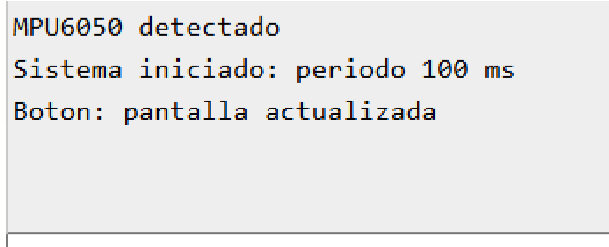

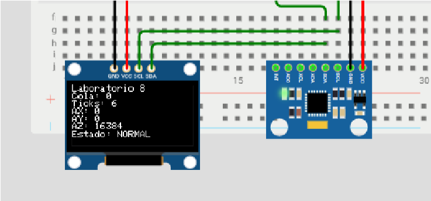

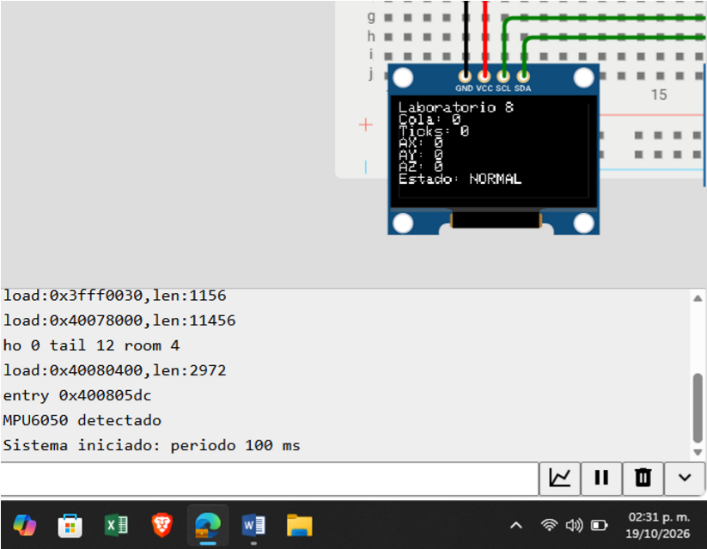

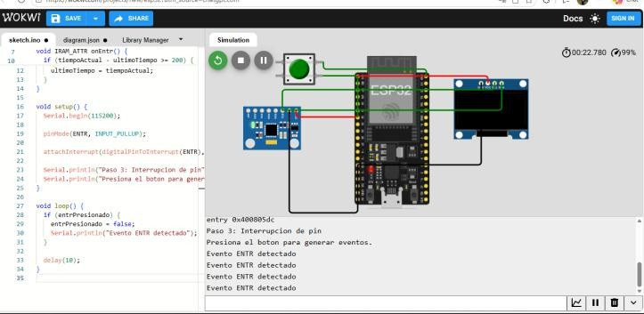

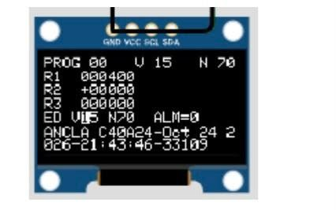

#### Interrupción del temporizador

Se configuró un temporizador del ESP32 para disparar una interrupción periódica. En cada disparo la ISR solo hace dos cosas: incrementa un contador de ticks y levanta una bandera que avisa que hay una tarea pendiente. No lee el sensor ni imprime nada.

El ciclo principal revisa la bandera y, cuando está activa, ejecuta el trabajo pesado: leer el MPU6050, actualizar los registros de E/S y refrescar la pantalla. Así la ISR dura microsegundos y el procesamiento ocurre con las interrupciones habilitadas.

El temporizador se configuró con la API de Arduino-ESP32 3.x: `timerBegin()`, `timerAttachInterrupt()` y `timerAlarm()`. El periodo normal de la simulación fue de 100 ms, y en el monitor serial se ve cómo el contador de ticks avanza de forma regular.

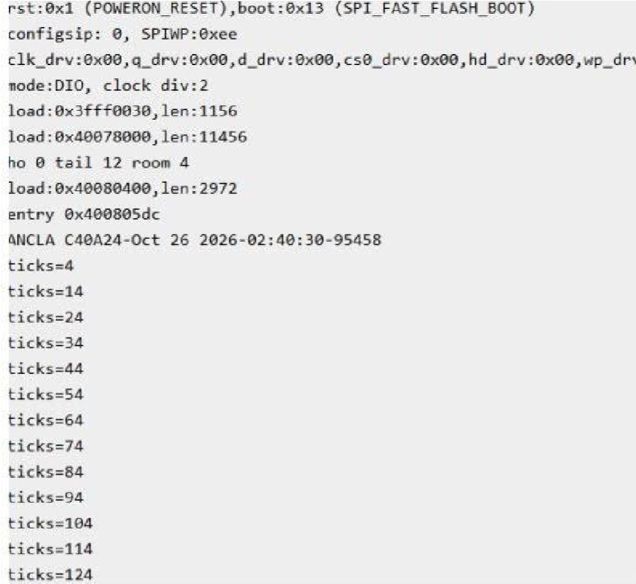

#### Interrupción del botón ENTR

El botón ENTR está conectado al GPIO 32 y a GND, con la resistencia pull-up interna activada (`INPUT_PULLUP`), de modo que la línea está en alto en reposo y baja a nivel bajo al presionar. La interrupción se asoció al flanco de bajada (`FALLING`), que corresponde al instante de la pulsación.

Para evitar que una sola pulsación se cuente varias veces, la ISR compara el tiempo actual con el de la última pulsación aceptada y descarta cualquier evento que llegue antes de 200 ms. La ISR, marcada con `IRAM_ATTR`, solo actualiza una bandera; el mensaje "Evento ENTR detectado" se imprime desde `loop()`.

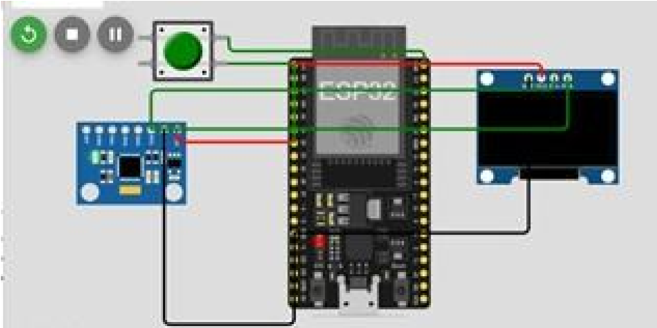

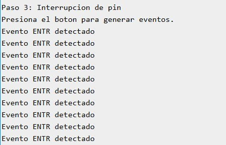

#### Alarma 1202 y recuperación

Para observar cómo se comporta la cola de tareas bajo carga, se redujo el periodo del temporizador de 100 ms a 2 ms. Con ese periodo se genera una tarea nueva cada 2 ms, un ritmo mayor al que el ciclo principal puede atender, pues cada tarea implica leer el sensor y actualizar la pantalla. La cola crece hasta saturarse y el sistema levanta la alarma 1202.

Al detectar la alarma, la AGC ejecuta un procedimiento de recuperación: marca la alarma como atendida, vacía la cola, reinicia la CPU con `cpuReset()` y conserva el contenido de `RAM[10]`. Por su parte, `RAM[20]` funciona como contador de alarmas 1202.

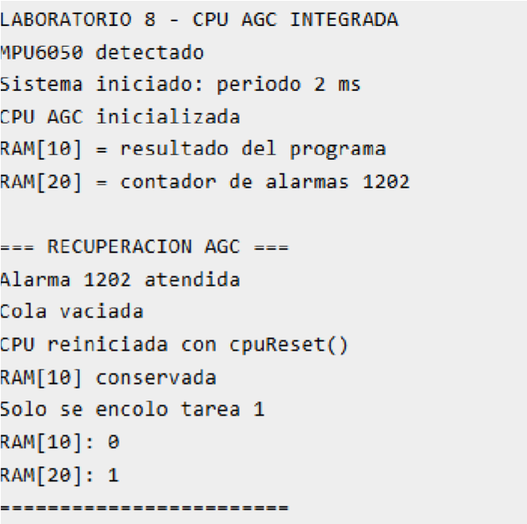

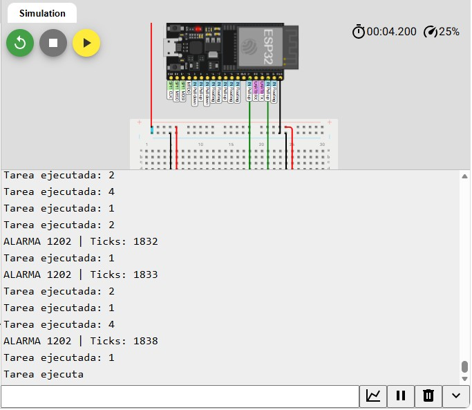

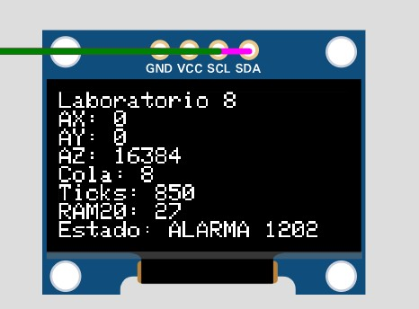

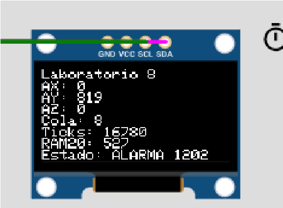

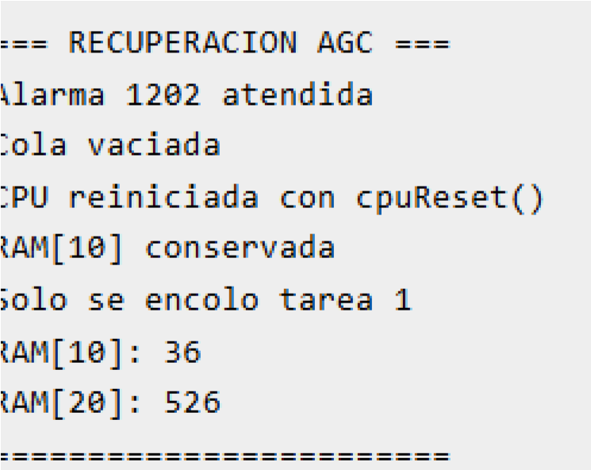

### Laboratorio 9

#### Paso 0. Revisar que todo funcione

Primero se armó el circuito en Wokwi. En el centro está el ESP32 y a su alrededor se conectan el sensor MPU6050, la pantalla OLED, el joystick y el botón ENTR.

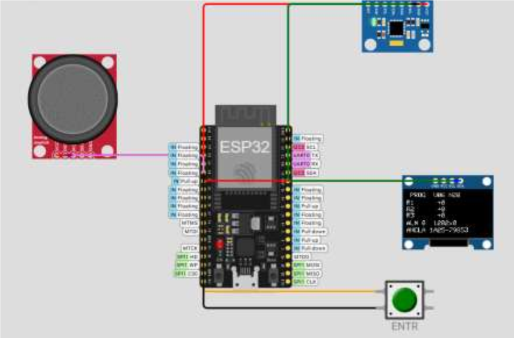

1. **Identificador de sesión.** Al iniciar la simulación, el programa muestra en el monitor una línea llamada ANCLA. Este dato cambia en cada inicio y sirve para identificar las capturas de esa ejecución. En esta prueba, el identificador fue `1A25-99832`.

   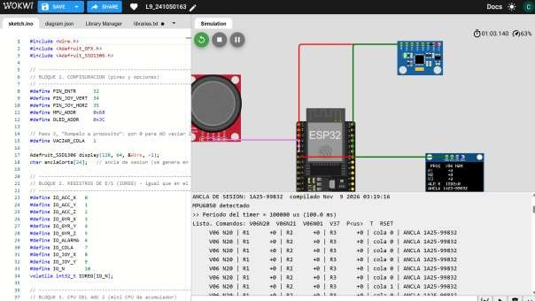

2. **V06 N20 (movimiento en X, Y y Z).** Al ingresar `V06 N20`, la pantalla muestra en R1, R2 y R3 el movimiento que detecta el sensor. Cuando no se mueve, los tres valores permanecen en cero. Después se cambiaron los controles del MPU6050 a 147, −152 y 181 grados por segundo. En la pantalla aparecieron R1 +19257, R2 −19912 y R3 +23711, lo que confirma que el sensor registra los movimientos.

   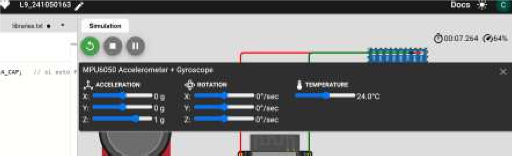

   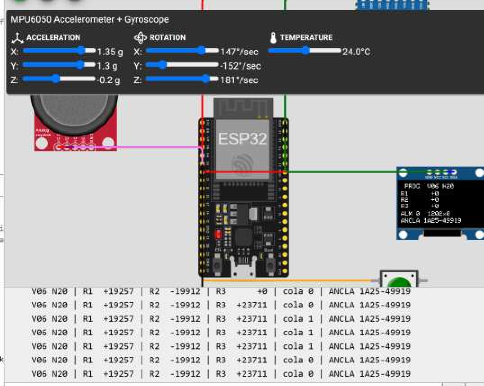

   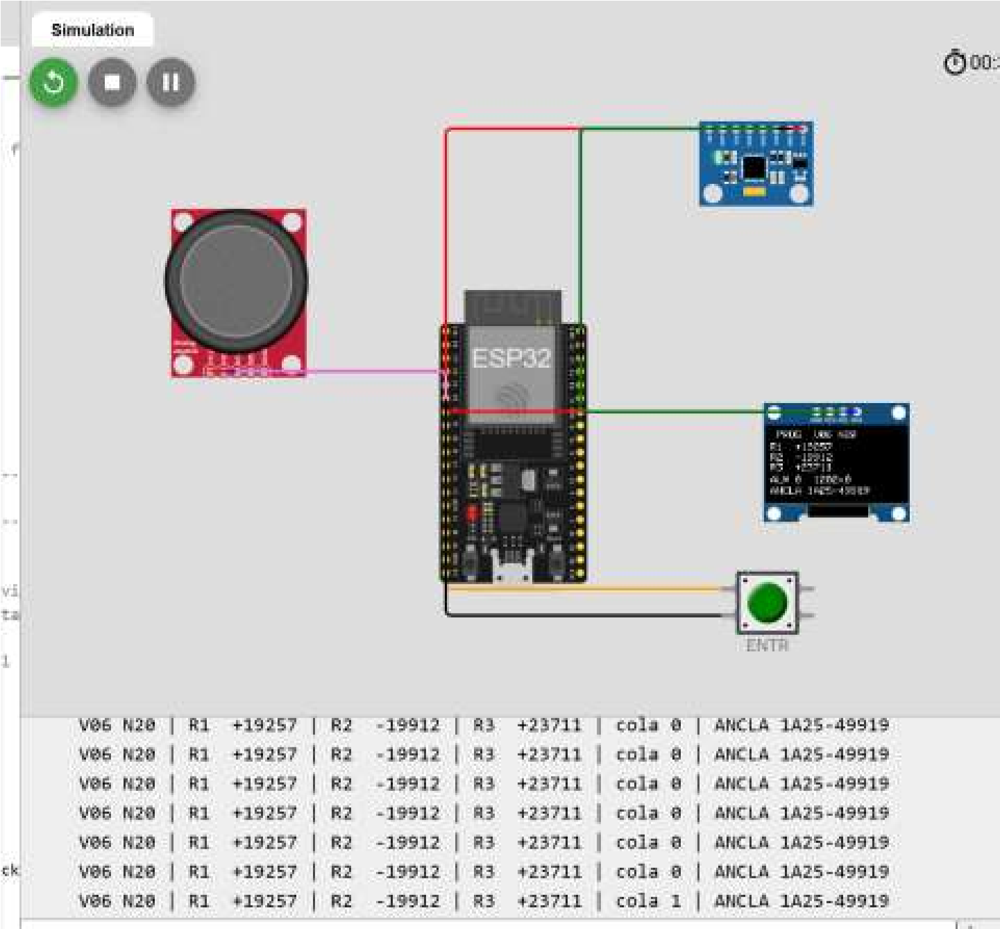

   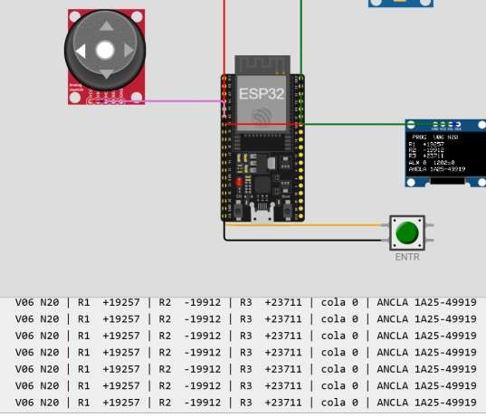

3. **Conteo de ticks.** En `V06 N21`, el registro R3 muestra cuántas señales del reloj interno han pasado. En la captura aumenta 5 unidades cada medio segundo (1015, 1020, 1025…). Esto equivale a 10 ticks por segundo y confirma que el reloj se activa cada 100 ms.

   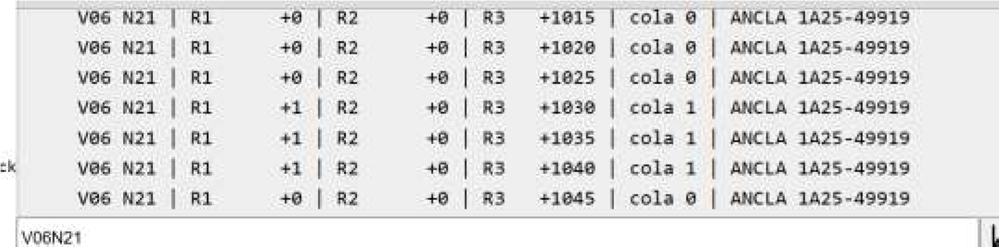

4. **Prueba del botón ENTR.** Se presionó el botón ENTR diez veces y el contador llegó a 10. Esto comprueba que cada pulsación se registra una sola vez.

   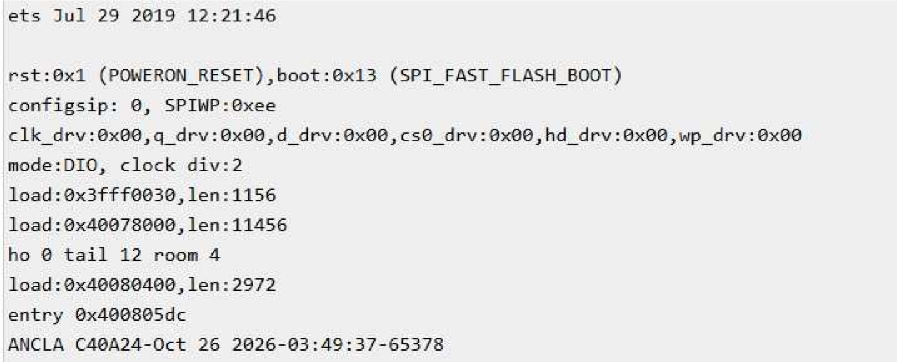

   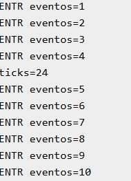

5. **Lectura del sensor fuera de la interrupción.** Cuando ocurre una interrupción, el programa solo aumenta el contador de ticks y avisa que hay una tarea pendiente. La lectura del sensor se realiza después, en `loop()`. Al principio se intentó leerlo directamente dentro de la interrupción, pero el ESP32 mostró el error "Interrupt wdt timeout" y se reinició. Esto ocurrió porque esa operación tardaba demasiado y el sistema pensó que se había quedado detenido.

   A) Variables y función de interrupción (antes de `setup()`):

   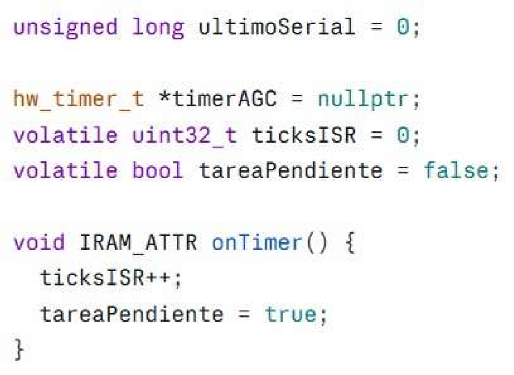

   B) Configuración al final de `setup()`:

   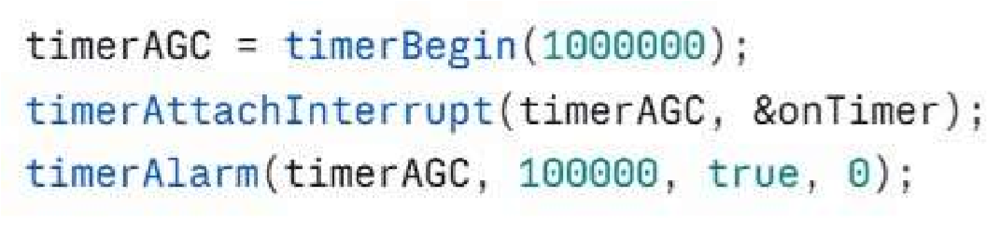

   C) Acciones al inicio de `loop()`, y el error "Interrupt wdt timeout" que apareció al leer el sensor dentro de la ISR:

   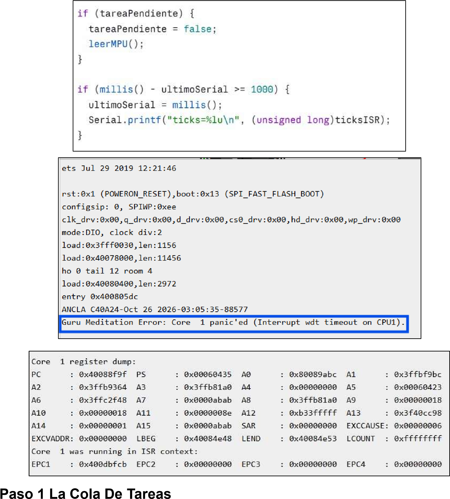

#### Paso 1. Organizar las tareas en una lista de espera

En la versión anterior, el reloj y el botón avisaban cuando había algo que hacer. El problema era que, si llegaban dos avisos muy seguidos, uno podía perderse. Para evitarlo, se cambió ese sistema por una lista de espera con ocho espacios. Así, cada tarea queda anotada y puede atenderse por orden, como cuando se toma un turno.

Ahora el reloj y el botón ENTR solo agregan tareas a la lista, mientras que `loop()` se encarga de realizarlas una por una. Como la lista tiene únicamente ocho espacios, puede llenarse si llegan más tareas de las que el sistema alcanza a completar. Para observar el comportamiento de la lista, la pantalla se configuró para comenzar directamente en `V06 N21`, donde se muestra cuántas tareas están pendientes.

**Tabla de tareas y de cuándo se agregan:**

| Código | Tarea | Quién la mete en la cola |
|---|---|---|
| 1 | Leer el sensor MPU6050 y actualizar los registros de entrada/salida | Temporizador (cada 100 ms) |
| 2 | Revisar los botones | Temporizador (cada 100 ms) |
| 3 | Actualizar la pantalla OLED | Botón ENTR y tarea 2 |
| 4 | Ejecutar diez pasos de la CPU | `loop()`, cada cinco vueltas |

**Ajustes realizados en el programa:**

**A) Crear la lista de espera.** Se preparó una lista circular con ocho espacios. Se llama circular porque, al llegar al último lugar, vuelve al primero. La función `encolar()` agrega una tarea al final y avisa si ya no hay espacio. Por otro lado, `desencolar()` retira la tarea que lleva más tiempo esperando. También se agregó una protección para evitar que la interrupción y `loop()` cambien la lista al mismo tiempo, así no se mezclan las tareas ni se pierde el orden.

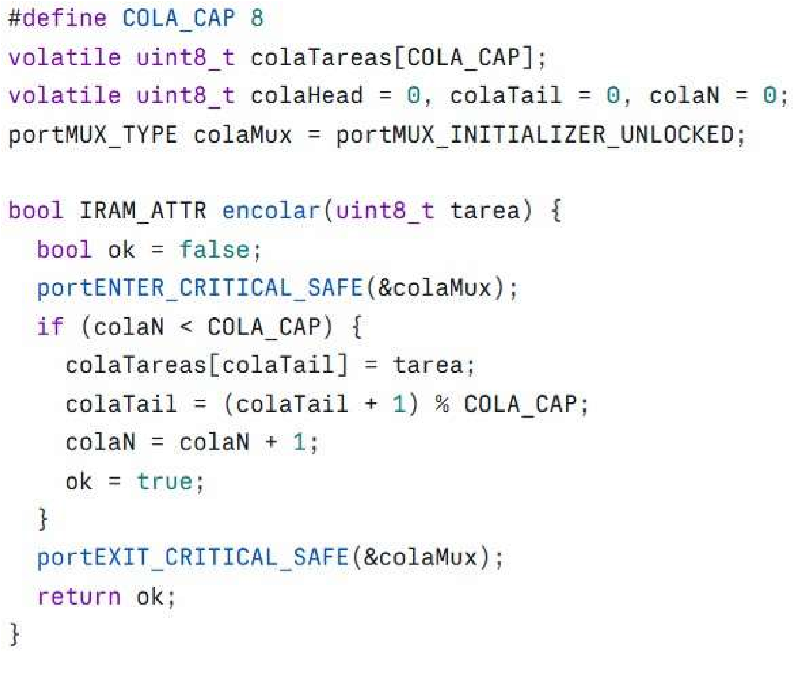

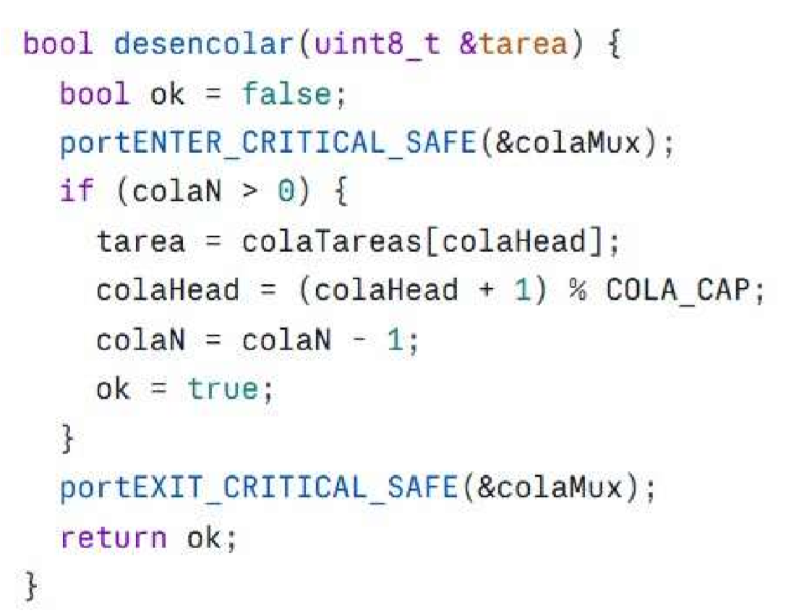

**B) Cómo se agregan las tareas.** Las interrupciones ahora registran tareas en la lista en lugar de limitarse a enviar avisos. Cada 100 ms, el reloj agrega la tarea 1 (leer el sensor) y la tarea 2 (revisar los botones). Cuando se presiona ENTR, se agrega la tarea 3 (actualizar la pantalla).

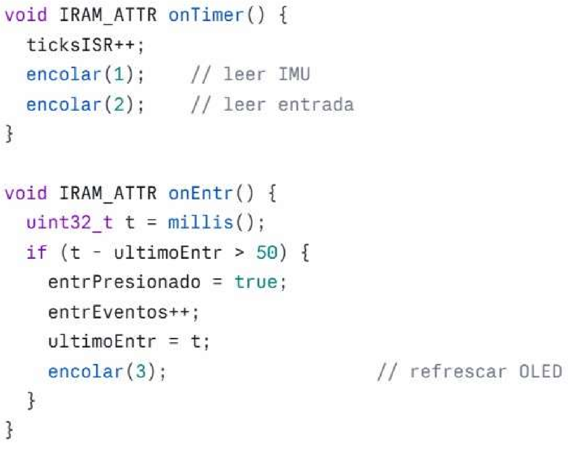

**C) Cómo se realizan las tareas.** En cada vuelta, `loop()` revisa la lista y realiza la siguiente tarea pendiente. Cada cinco vueltas también agrega la tarea 4 (diez pasos de la CPU). Además, el programa guarda en `IOREG[IO_COLA]` la cantidad de tareas que siguen esperando, para mostrarla en la pantalla. También se separó la lectura de los botones y la actualización de la pantalla en dos funciones: `tareaLeerEntrada()` y `tareaOLED()`. Por último, se agregó el sustantivo 21 al DSKY para consultar el estado de la lista.

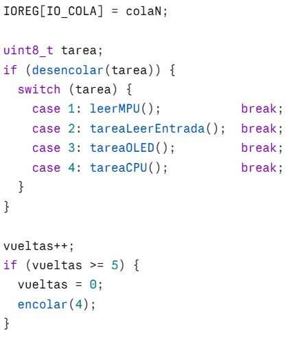

**Revisión del resultado en el DSKY.** Se seleccionó el verbo 06 y el sustantivo 21. En esta pantalla, R1 indica cuántas tareas están pendientes, R2 muestra si existe una alarma y R3 lleva el conteo de los ticks del reloj. Con el reloj en 100 ms, R1 muestra +00001 (casi siempre no hay tareas pendientes o solo queda una), R2 muestra +00000 (no hay alarma) y R3 indica +00042; la captura se tomó aproximadamente cuatro segundos después de iniciar, con un ritmo de diez ticks por segundo.

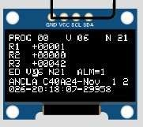

El monitor muestra el mismo resultado: el programa inicia, presenta el identificador de sesión y el contador de ticks sigue aumentando. Esto confirma que, con un intervalo de 100 ms, el sistema alcanza a realizar las tareas y la lista no llega a llenarse.

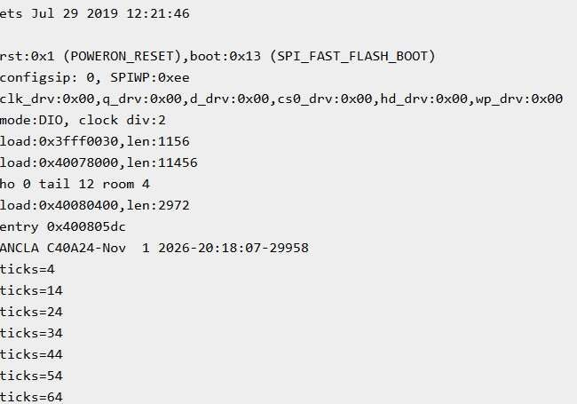

#### Paso 3. Recuperar el funcionamiento del sistema

Cuando `encolar()` detecta que la lista está llena y aparece la alarma 1202, el programa realiza una serie de acciones para volver a funcionar. Después de recuperarse, sigue mostrando el movimiento del sensor en `V06 N20`, aunque la alarma vuelva a presentarse.

| Orden | Acción |
|---|---|
| 1 | Vaciar la lista de tareas |
| 2 | Reiniciar la CPU del AGC 2 con V37 automático, conservando `RAM[10]` |
| 3 | Agregar nuevamente solo la tarea 1 (sensor IMU) |
| 4 | Aumentar `RAM[20]` en una unidad para contar la alarma 1202 |
| 5 | Conservar el intervalo que provocó la alarma (50 ms) |

**Cambios realizados en el programa:**

1. La función `encolar()` ya no intenta recuperar todo el sistema desde la interrupción, porque esa operación podría tardar demasiado y provocar que la placa se bloquee. En su lugar, solo registra que es necesario iniciar la recuperación:

   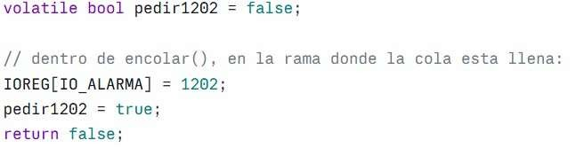

2. Esta función realiza la recuperación cuando `loop()` detecta que hay una alarma pendiente:

   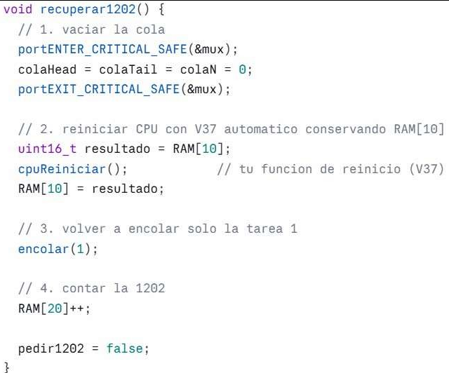

3. Al inicio de `loop()`:

   

4. El valor de `RAM[20]` se establece en cero una sola vez, al iniciar `setup()`, y no se borra cuando se reinicia la CPU. De esta forma, el contador conserva el total de alarmas 1202 que han ocurrido desde que se encendió el sistema.

**Comprobación de la recuperación en el DSKY.** Se configuró el reloj en 50 ms y se dejó funcionar el sistema durante 60 segundos. Al consultar `V06 N01`, la pantalla mostró `RAM[20] = +00010`. Esto significa que apareció la alarma 1202 diez veces y que el sistema logró recuperarse en cada ocasión, sin apagarse por completo. Después se cambió a `V06 N20` y se movieron los controles del MPU6050: los valores siguieron cambiando, lo que demuestra que el sensor continuó funcionando.

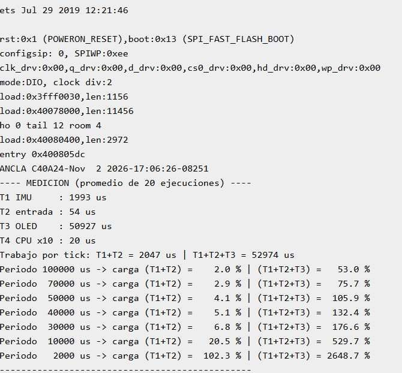

![Registro de ticks, alarma 1202 y RAM[10]](../evidencias/lab9_31_contador_ram20.png)

![DSKY en V06 N01: RAM[20] = +00010](../evidencias/lab9_32_dsky_ram20_10.png)

## Midió

### Laboratorio 8

**Botón ENTR con antirrebote de 200 ms:**

| Prueba | Pulsaciones | Eventos detectados | Diferencia |
|---|---|---|---|
| Con antirrebote de 200 ms | 10 | 10 | 0 |

Con el antirrebote de 200 ms, cada una de las 10 pulsaciones produjo exactamente un evento. El intervalo mínimo filtra las variaciones rápidas de la señal justo después de cada pulsación.

**Resultados obtenidos:**

- El MPU6050 se detectó en la dirección 0x68 y se leyeron 14 bytes consecutivos por I2C.
- Los datos de aceleración y velocidad angular quedaron disponibles en los registros de E/S de la AGC (`IO_ACC_*` e `IO_GYR_*`).
- Con la placa en reposo, el eje Z marcó 16384, equivalente a 1 g en la escala de ±2 g.
- El temporizador periódico generó interrupciones cuya ISR solo incrementa ticks y levanta una bandera.
- El botón ENTR (GPIO 32) con flanco de bajada y antirrebote de 200 ms registró 10 eventos en 10 pulsaciones.
- Con periodo de 2 ms se produjo la alarma 1202 por saturación de la cola de tareas.
- La recuperación vació la cola, reinició la CPU y conservó `RAM[10]`.

### Laboratorio 9

#### Paso 2. Provocar la alarma 1202

Se probaron siete intervalos para el reloj, desde 100 ms hasta 2 ms. Con 100 ms y 70 ms, la lista no se llenó durante los 60 segundos de prueba. En cambio, desde 50 ms y con intervalos menores, los ocho espacios terminaron ocupándose y apareció la alarma 1202. Mientras más seguido se generan las tareas, menos tiempo tiene el sistema para atenderlas. Por ejemplo, con 50 ms la alarma apareció después de 58 ticks (aproximadamente 2.9 segundos), mientras que con 2 ms apareció después de solo 6 ticks (unos 12 milisegundos).

| Periodo del timer | ¿Apareció la alarma 1202? | Ticks antes de la alarma | Tiempo aproximado |
|---|---|---|---|
| 100 ms | No (599 ticks en 60 s) | No aplica | No aplica |
| 70 ms | No (857 ticks en 60 s) | No aplica | No aplica |
| 50 ms | Sí | 58 | 2.9 s |
| 40 ms | Sí | 14 | 560 ms |
| 30 ms | Sí | 8 | 240 ms |
| 10 ms | Sí | 6 | 60 ms |
| 2 ms | Sí | 6 | 12 ms |

El intervalo más corto que no provocó la alarma fue de 70 ms, mientras que con 50 ms sí apareció. Por lo tanto, el límite de funcionamiento de este sistema se encuentra entre esos dos valores.

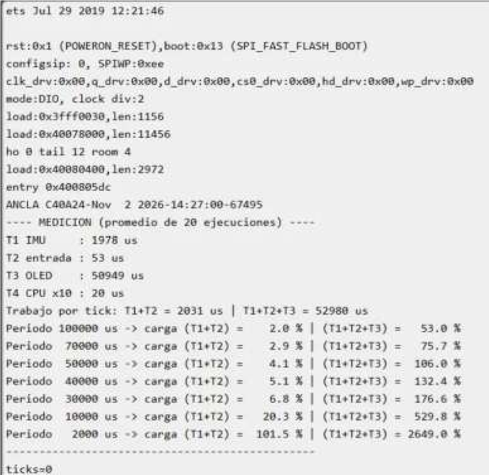

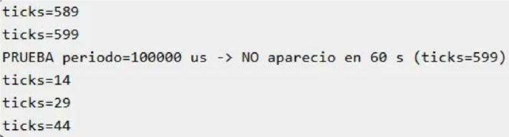

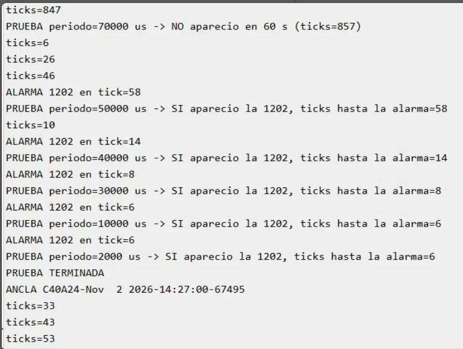

**Captura del momento en que aparece la alarma 1202.** Se observa cuándo la lista se llena: el registro R2 cambia de 0 a 1202 y se enciende el indicador PROG. La alarma aparece porque `encolar()` detecta que ya no hay espacios disponibles para guardar otra tarea y registra el código 1202.

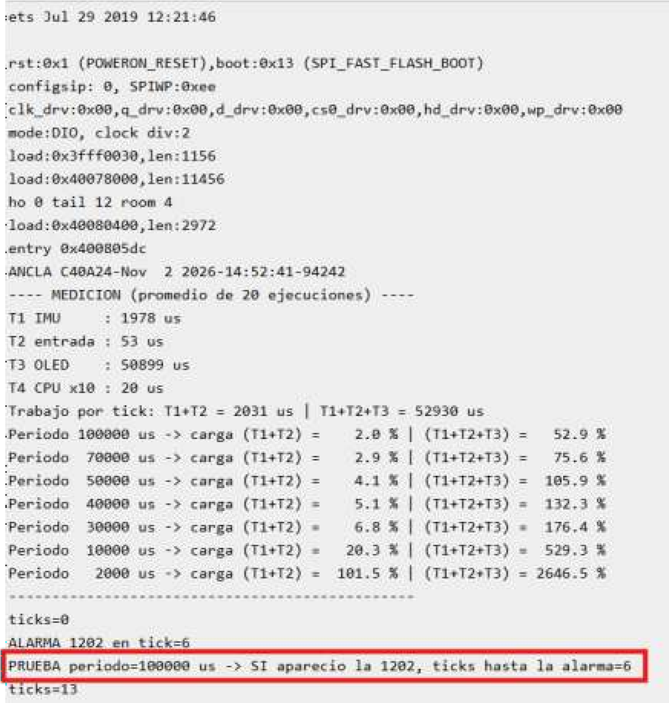

#### Cuánto tarda cada tarea

Se midió el tiempo de cada tarea con `micros()`, que permite medir en millonésimas de segundo. Para un resultado más confiable, cada medición se repitió 20 veces y se calculó el promedio.

| Tarea | Tiempo empleado |
|---|---|
| T1. Sensor IMU | 1 978 µs |
| T2. Botones | 53 µs |
| T3. Pantalla OLED | 50 949 µs |
| T4. Diez pasos de CPU | 20 µs |

La pantalla tarda mucho más que las demás tareas porque debe enviar la imagen por la conexión I2C. Por eso, es la actualización de la pantalla la que más influye en que la lista se llene.

#### Porcentaje de tiempo que ocupa el sistema

Como la tarea 2 también provoca que se actualice la pantalla, en cada ciclo se consideran los tiempos T1 + T2 + T3. La suma es 1 978 + 53 + 50 949 = **52 980 µs**.

- La alarma apareció con el reloj en 50 ms (50 000 µs): Carga = 52 980 ÷ 50 000 × 100 = **106 %**. Las tareas necesitan más tiempo del que tienen disponible.
- Con 70 ms, intervalo en el que no apareció la alarma: 52 980 ÷ 70 000 × 100 = **75.7 %**. El sistema todavía tiene tiempo para completar las tareas.
- El punto en el que se alcanza el 100 % de carga es 52 980 µs, aproximadamente 53 ms. Esto coincide con las pruebas: a 50 ms apareció la alarma y a 70 ms no.
- Si se toma únicamente T1 + T2 = 2 031 µs, el resultado para 50 ms sería 2 031 ÷ 50 000 × 100 = 4.1 %. Ese cálculo no incluye la actualización de la pantalla, que también se genera a partir de la tarea 2 y representa la mayor parte del tiempo.

#### Cambios realizados para las mediciones

- Se agregaron los intervalos de 70, 50 y 40 ms a la lista de pruebas y se ordenaron de mayor a menor.
- Se incorporó la función `medirTareas()`, que mide cada actividad 20 veces antes de iniciar el reloj y calcula cuánto tiempo ocupa cada intervalo.
- Durante las mediciones se hizo que la pantalla se actualizara por completo, para revisar el escenario que requiere más tiempo.
- Antes de cada prueba se vació la lista de espera, para comenzar en las mismas condiciones y evitar alarmas anteriores.

#### Prueba final: ¿qué pasa si quitamos la recuperación?

| Caso | Alarmas 1202 en 60 s | ¿V06 N20 sigue funcionando? |
|---|---|---|
| Con vaciado | 10 | Sí |
| Sin vaciado | 1200 | No |

Se quitó intencionalmente el paso de vaciar la lista. Cuando la recuperación está activada, durante 60 segundos aparecen 10 alarmas 1202 y `V06 N20` sigue respondiendo al movimiento del sensor. Cuando se elimina el vaciado, la lista se queda ocupada con tareas anteriores y las alarmas aumentan hasta aproximadamente 1200 en el mismo periodo. En ese caso, el sistema deja de responder y la pantalla se congela.

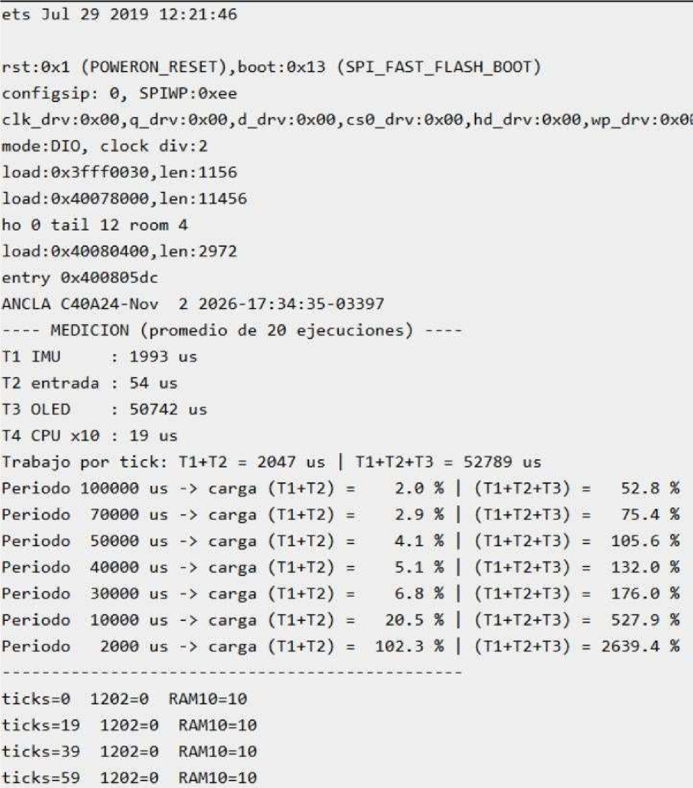

## Argumentó

### Laboratorio 8

**¿Por qué las lecturas del giroscopio en reposo no suelen ser exactamente cero? ¿Por qué Wokwi puede mostrar cero?**

En un sensor real el giroscopio casi nunca marca cero aunque no se mueva. Tiene un offset de fábrica, produce ruido electrónico y su salida se desplaza con la temperatura. Por eso, en la práctica, los sistemas reales miden unas decenas de muestras en reposo y restan ese promedio. Wokwi simula el chip como un modelo ideal: si el sensor virtual no se mueve, entrega valores constantes y sin ruido, y por eso las lecturas pueden salir en cero. Lo que se ve en la simulación es el caso limpio; con hardware físico habría que añadir una calibración.

**¿Qué ocurre al colocar la lectura I2C dentro de la ISR y por qué?**

Como prueba, se movió la lectura I2C al interior de la rutina de interrupción para compararla con el diseño correcto. Una lectura I2C de 14 bytes involucra enviar la dirección, esperar la respuesta del sensor y recibir los datos, y a 100 o 400 kHz eso toma cientos de microsegundos o más. Dentro de una ISR, ese tiempo se pasa con otras interrupciones retenidas y con el ciclo principal detenido. Además, la librería I2C usa esperas y recursos internos que no están pensados para ejecutarse en contexto de interrupción, lo que puede producir bloqueos o reinicios del ESP32. La regla de diseño es que la ISR registre el evento y el ciclo principal haga la lectura y el procesamiento.

**¿Para qué sirve `IRAM_ATTR` y por qué no se recomienda `Serial.print()` dentro de una ISR?**

`IRAM_ATTR` coloca la función en la RAM interna de instrucciones del ESP32 en lugar de la memoria flash. El código en flash se carga mediante una caché, y durante ciertas operaciones (como escribir en flash) esa caché se deshabilita; si una interrupción cae en ese momento y su código está en flash, el sistema falla. Por eso las ISR deben marcarse con `IRAM_ATTR`. `Serial.print()` no es adecuado en una ISR porque usa buffers compartidos, puede esperar a que el puerto serial libere espacio y tarda mucho más que una ISR aceptable. La alternativa es guardar el evento en una variable y que `loop()` lo imprima.

**¿Por qué en Wokwi se registran exactamente 10 eventos y con un botón físico el resultado podría ser distinto? ¿Qué elemento físico no representa completamente el simulador?**

Un botón físico es un contacto mecánico: al cerrarse, las láminas rebotan durante unos milisegundos y la señal oscila entre alto y bajo varias veces antes de estabilizarse. Sin filtrado, el microcontrolador vería varios flancos de bajada por pulsación. Con un botón real y un intervalo mal elegido, el conteo podría salir mayor o menor. El simulador entrega una transición limpia, sin rebote. Lo que no modela es el comportamiento eléctrico del contacto mecánico, que además se puede mitigar por hardware con un capacitor o un circuito RC.

**¿Cuál es la diferencia entre sondeo (polling) e interrupciones?**

En el sondeo, el programa pregunta una y otra vez si ocurrió el evento. Es sencillo y predecible, pero gasta tiempo de CPU en consultas que casi siempre dicen "nada nuevo", y la latencia depende de cada cuánto se consulta. Con interrupciones, es el hardware el que avisa: la CPU hace otro trabajo y solo se desvía cuando ocurre el evento, con una latencia muy corta. El costo es que la ISR interrumpe lo que se estaba ejecutando, así que debe ser breve y cuidar las variables compartidas con el programa principal.

**¿Qué representan las alarmas 1201 y 1202 en el contexto de la AGC?**

Son alarmas de sobrecarga del sistema ejecutivo de la AGC del Apollo: indican que había más trabajo pendiente del que el procesador podía organizar y completar a tiempo. La 1201 señala que se agotó el espacio para nuevos "núcleos" de trabajo, y la 1202 que se agotaron las áreas de vector de trabajo. Ambas se hicieron famosas durante el descenso del Apollo 11, cuando el radar de encuentro generó carga extra de procesamiento. El diseño del ejecutivo respondió a la sobrecarga reiniciando el software y conservando solo las tareas críticas. En esta práctica el equivalente es la saturación de la cola de tareas: cuando entran más tareas de las que el ciclo principal alcanza a procesar, el sistema levanta la alarma 1202, atiende el problema y se recupera.

**Qué confirma la prueba de 2 ms.** Primero, que la saturación se produce por la relación entre la frecuencia con que se generan tareas y el tiempo que tarda cada una, no por una falla del código. Segundo, que la recuperación funciona: después del reinicio la cola queda vacía, el trabajo no esencial se descarta y el resultado guardado en `RAM[10]` no se pierde.

### Laboratorio 9

**1. ¿Qué chipset tiene mi computadora y qué controladores utiliza?**

Mi computadora es una Acer Aspire A315-24P con Windows 11 Home y un procesador AMD Ryzen 5 7520U with Radeon Graphics, con 8 GB de RAM instalada. En el Administrador de dispositivos aparecen los controladores de almacenamiento (controladora NVM Express y controladora de espacios de almacenamiento de Microsoft), los controladores USB (hosts AMD USB 3.10 y 2.0, concentradores raíz) y los dispositivos del sistema de AMD (por ejemplo GPIO, I2C, SMBus, coprocesador de audio y controlador de acceso directo a memoria).

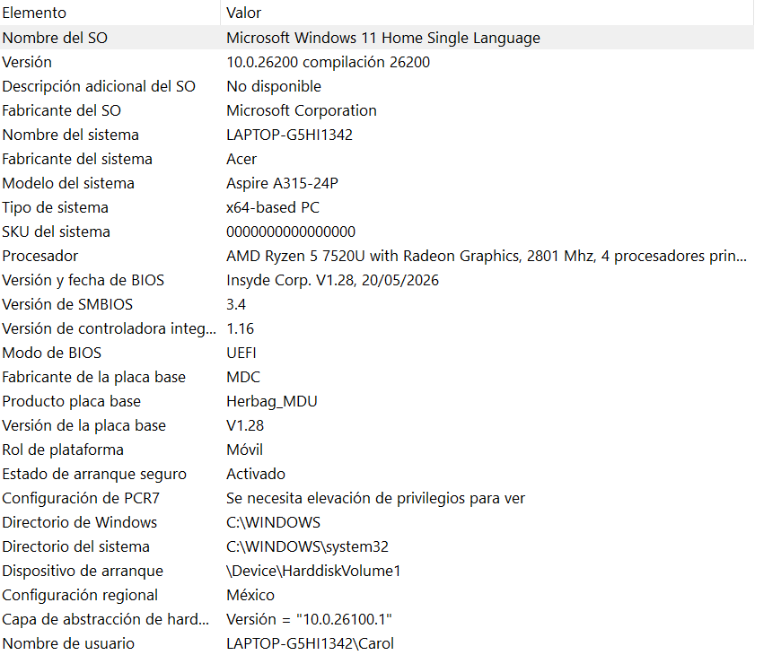

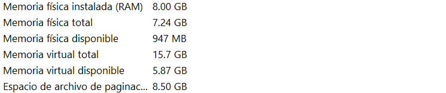

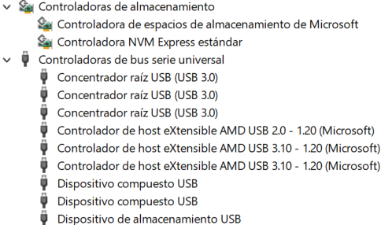

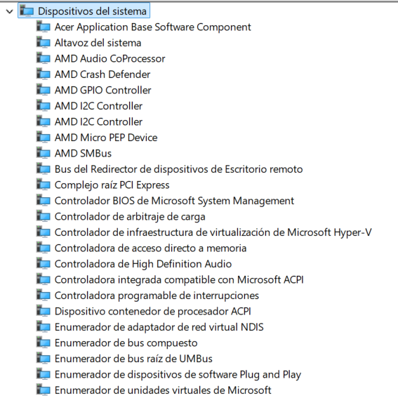

**2. Registros necesarios para que el DMA trabaje con mi AGC**

Los espacios del 0 al 12 del IOREG ya se utilizan para otras funciones. Por eso, los registros del DMA se reservaron a partir del número 13:

| Offset | Registro | Qué guarda |
|---|---|---|
| 13 | `DMA_ORIGEN` | Dirección de origen de los datos |
| 14 | `DMA_DESTINO` | Dirección de destino |
| 15 | `DMA_CONTADOR` | Cantidad de palabras por copiar; disminuye con cada copia y al llegar a cero termina |
| 16 | `DMA_CONTROL` | Inicia la copia e indica cómo se realizará |
| 17 | `DMA_ESTADO` | Indica si el proceso está ocupado o terminó (opcional) |

De esta manera, el DMA puede mover los datos sin que la CPU tenga que copiarlos uno por uno.

**3. ¿Qué es bus mastering y por qué las tarjetas PCIe tienen su propio motor DMA?**

El bus mastering permite que un dispositivo use el bus para leer o escribir datos en la memoria sin que la CPU tenga que hacer cada movimiento. Antes, varios dispositivos compartían un solo controlador DMA y debían esperar su turno; era parecido a tener un único acceso para toda una escuela. En cambio, muchas tarjetas PCIe actuales cuentan con su propio motor DMA, lo que les permite trabajar de forma más independiente y reduce las esperas.

**4. ¿Qué indican las alarmas 1201 y 1202?**

Las dos alarmas indican que la computadora del Apollo tenía demasiadas tareas y se había quedado sin espacio para organizarlas. La alarma 1202 aparece cuando ya no hay espacios para registrar trabajos pendientes, mientras que la 1201 se relaciona con la falta de áreas de memoria necesarias para ciertos cálculos. Durante el Apollo 11 se presentaron varias alarmas 1202 y una 1201 porque el radar enviaba información que no era necesaria en ese momento. La computadora pudo recuperarse, conservar las tareas importantes y continuar con el aterrizaje.

**Comparación con el 15 % del Apollo 11**

En mi sistema, la lista se llenó cuando las tareas necesitaban el 106 % del tiempo disponible. En el Apollo 11, el radar agregaba una carga cercana al 15 %. Estos porcentajes no se pueden comparar directamente: en el Apollo, ese 15 % se sumaba a otras tareas que ya ocupaban gran parte de la computadora. En ambos casos, el problema aparece cuando llegan más tareas de las que se pueden atender y se llena el espacio disponible. En mi caso, la pantalla OLED es la tarea que más tiempo consume: representa aproximadamente el 96 % del trabajo de cada ciclo (50 949 de 52 980 µs), porque envía la imagen completa mediante la conexión I2C a 400 kHz. Por eso, el retraso no se debe principalmente a la velocidad del procesador, sino al tiempo que tarda en actualizarse la pantalla.

**Si se debe elegir entre conservar la tarea 1 (sensor IMU) o la tarea 3 (pantalla OLED), ¿cuál es más importante en un módulo lunar y cuál en un tablero de museo?**

En un módulo lunar debe mantenerse la tarea 1, que lee el sensor, y dejar en pausa la tarea 3, que actualiza la pantalla. El sensor proporciona la información necesaria para saber cómo se mueve y hacia dónde se dirige la nave; si esa información falta durante el descenso, podría ponerse en riesgo la misión. La pantalla sirve para mostrar los datos, pero puede esperar un momento sin afectar directamente la navegación.

En un tablero de museo, la prioridad puede ser la contraria: mantener la pantalla y dejar en pausa el sensor. Lo más importante es que los visitantes puedan ver la información de la exposición. Si se pierde una lectura del sensor, probablemente no ocurra algo grave; pero si la pantalla deja de funcionar, la exhibición ya no cumple su propósito. La prioridad cambia según la función del sistema y las consecuencias de que una tarea deje de realizarse.

**¿Qué demuestra la prueba sin vaciado?**

Cuando se quita el paso de vaciar la lista, esta se queda ocupada con tareas anteriores, las alarmas llegan a unas 1200 en 60 segundos y el sistema deja de responder. Con el vaciado solo hay 10 alarmas y `V06 N20` sigue funcionando. Esto demuestra que vaciar la lista es necesario para que el programa pueda recuperarse y continuar trabajando.

### Uso de la IA

- **Laboratorio 8:** se utilizó la ayuda de la IA para corregir errores y resolver dudas sobre la práctica en Wokwi.
- **Laboratorio 9:** se utilizó Claude (Anthropic) como apoyo para comprender las instrucciones y entender mejor el funcionamiento de las diferentes partes del proyecto.
