# AGC 4 – DMA y video (Laboratorio 11)

**Propósito.** En este laboratorio le dimos nuevas capacidades a nuestra computadora AGC (la del Apollo), que simulamos en una ESP32. Le agregamos un *framebuffer*, que es la memoria de video: el lugar donde se guarda la imagen que aparece en pantalla. También construimos un controlador **DMA** (acceso directo a memoria), que funciona como un ayudante que copia bloques de datos, por ejemplo una imagen, de un lugar a otro sin que la CPU tenga que hacerlo dato por dato. Con esto comprobamos cómo trabajan los dos modos de copia, ráfaga y robo de ciclo, y medimos cuántos datos por segundo puede recibir nuestra pantalla OLED.

## Funciona

### Paso 1: Configuración del entorno en Wokwi y carga del código base

Lo primero fue armar el circuito simulado en Wokwi. Usamos una ESP32 Dev Module como cerebro de la AGC y le conectamos tres componentes:

- **Pantalla OLED SSD1306 (128x64):** funciona como el DSKY, la consola con pantalla del Apollo. Se conectó a los pines SDA (21) y SCL (22) del ESP32, que forman el bus I2C (el "cable" de comunicación que comparten la pantalla y el sensor), y a la alimentación (VCC a 3V3 y GND a GND).
- **Sensor MPU6050:** sirve para simular los datos de movimiento y orientación. Está conectado al mismo bus I2C que la pantalla (pines SDA 21 y SCL 22), con VCC a 3V3 y GND a GND.
- **Botón pulsador (ENTR):** simula la tecla "Enter" de la consola original. Se conectó al pin GPIO 32 del ESP32, con la resistencia pull-up interna activada (hace que el pin se mantenga en nivel alto mientras no se presiona el botón), y su otra terminal a GND.

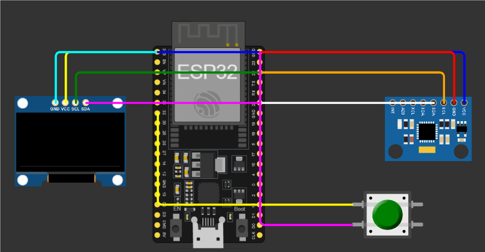

**Configuración del software.** Con el circuito listo, preparamos el código base. En el editor de Wokwi, dentro del archivo `sketch.ino`, cambiamos una línea importante: `#define N_SUMA 7` pasó a ser `#define N_SUMA 4`. Este cambio sale de la regla del laboratorio: se toma el último dígito del número de control (241050161), que es 1, y se le suma 3. Este valor indica cuántos números suma el programa de prueba de la CPU simulada.

Iniciamos la simulación con el botón Play y abrimos el Monitor Serie a 115200 baudios, con la opción de nueva línea activada. El sistema arrancó correctamente y mostró la línea que identifica nuestra sesión:

```
ANCLA C40A24-Nov 25 2026-04:12:27-66972
```

Desde ese momento, el monitor mostró información del sistema cada segundo (por ejemplo: `T=11 V=06 N=01 R1=0 R2=10 R3=0`). El valor `R2=10` confirma que la CPU sumó bien 1+2+3+4, los números definidos con `N_SUMA`. Es decir, el "cerebro" de la computadora funcionaba correctamente.

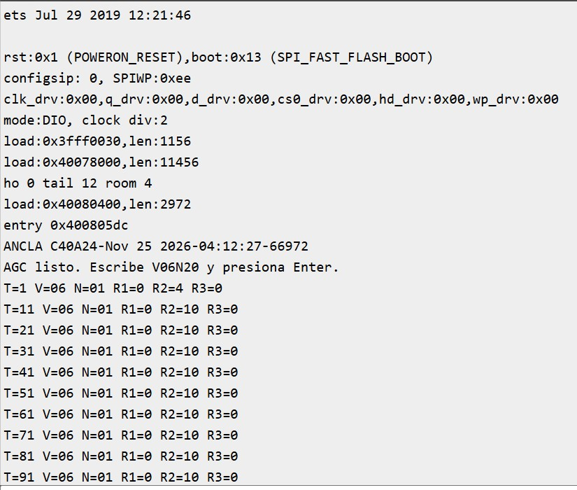

### Paso 2: Ampliación del mapa de memoria

Agregamos el siguiente código:

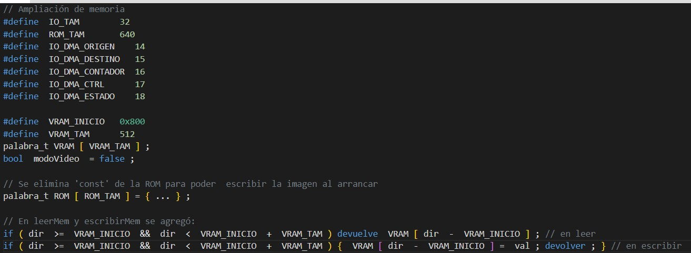

Aumentamos el espacio reservado para Entrada/Salida (`IO_TAM`) a 32 palabras para dar lugar a los nuevos registros del DMA, y creamos el arreglo de la VRAM (la memoria de video). También ampliamos la ROM a 640 palabras para poder guardar en ella una imagen de prueba.

Para comprobarlo, escribimos `W800,FFFF` (guardar un dato en la VRAM) y después `V01N01`. El registro R1 del monitor mostró -1, que en octal de 16 bits es 177777. Esto demuestra que la CPU ya reconoce la nueva zona de memoria.

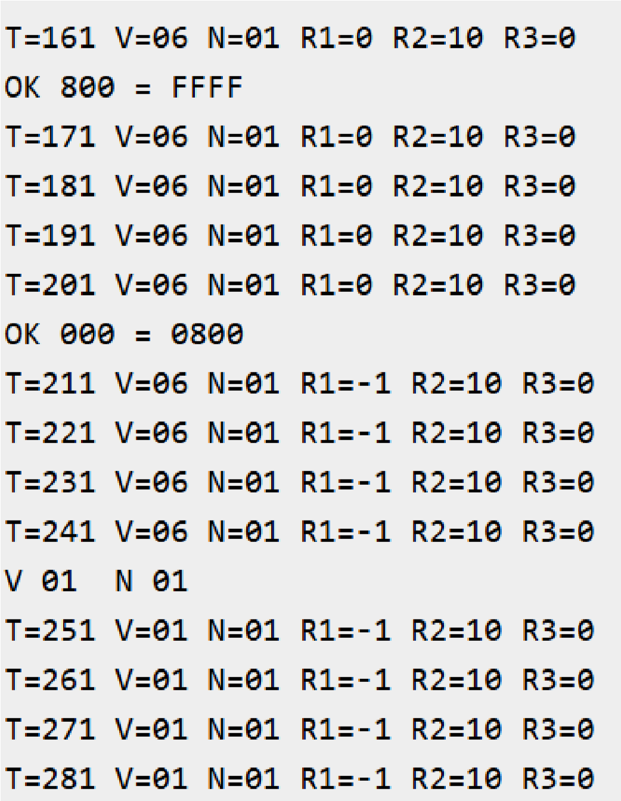

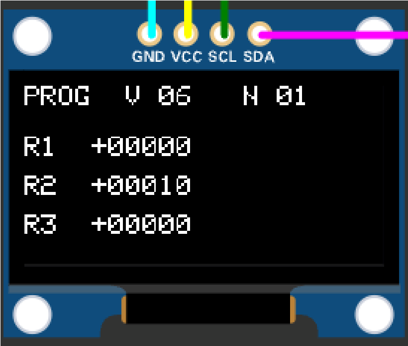

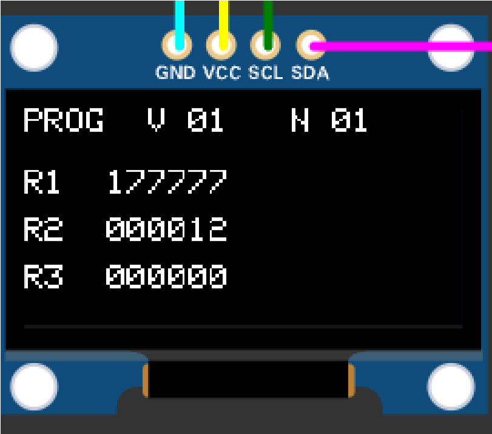

### Paso 3: La memoria de video (framebuffer)

Agregamos el siguiente código:

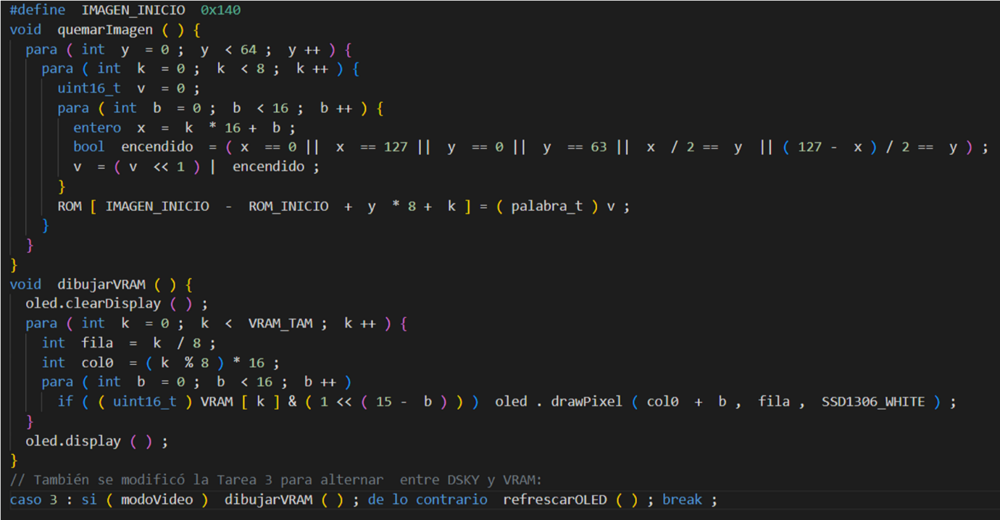

Creamos la función `quemarImagen()`, que dibuja un marco y dos diagonales en la ROM cuando arranca el programa. También creamos `dibujarVRAM()`, que convierte los bits de la VRAM en puntos encendidos o apagados (píxeles) en la pantalla OLED.

Al escribir `V35` entramos al modo video y apareció la imagen. Al escribir `W808,FFFF` se encendió una línea blanca de 16 píxeles, y al escribir `W801,8001` se encendieron exactamente los píxeles 16 y 31.

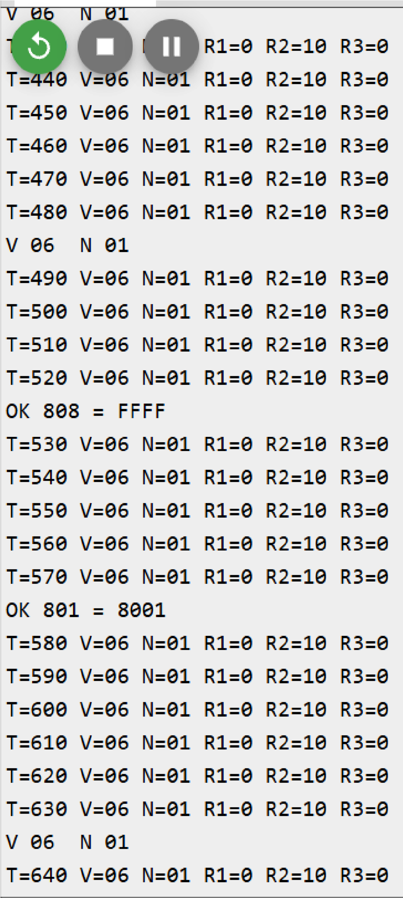

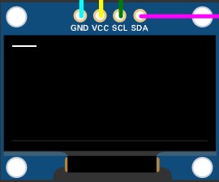

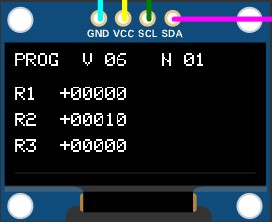

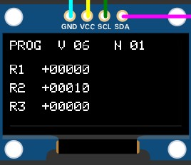

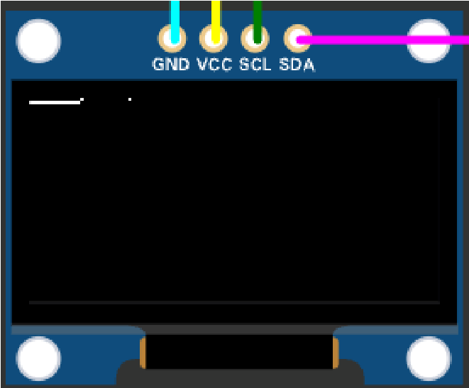

### Paso 4: El controlador DMA

Implementamos un controlador DMA con registros ubicados en la zona de Entrada/Salida. Su trabajo es copiar bloques de datos, en este caso la imagen de la ROM hacia la VRAM, para que la CPU no tenga que hacerlo. Probamos dos modos de funcionamiento y comprobamos que el sistema protege la memoria. Agregamos el siguiente código:

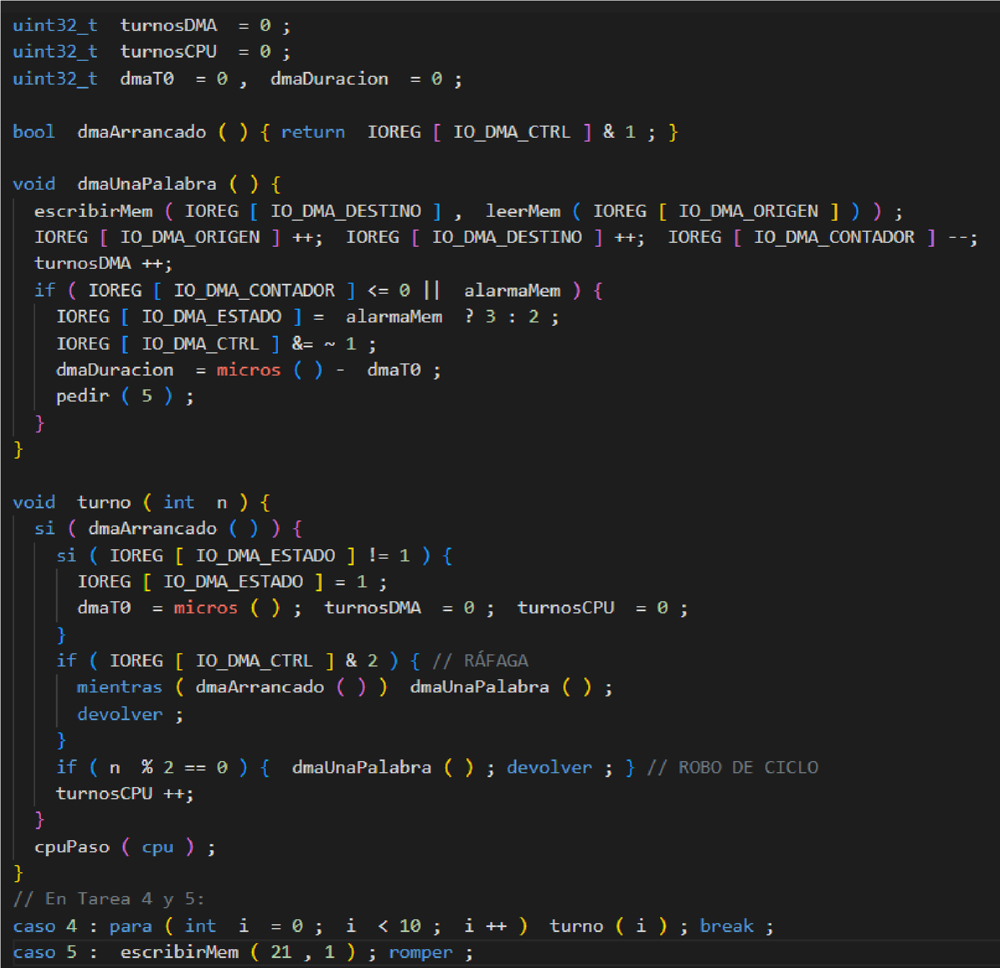

#### Prueba 1: Modo ráfaga (burst)

En este modo, el DMA toma el control del bus de datos (el "camino" por donde viajan los datos) y no lo suelta hasta terminar la copia completa. Para probarlo, escribimos estos comandos uno por uno en el Monitor Serie:

| Comando | Qué hace |
|---|---|
| `V36` | Limpia la pantalla y la VRAM. |
| `V35` | Enciende el modo de video. |
| `W04E,0140` | Indica de dónde se copia (dirección 0x140, donde está la imagen en la ROM). |
| `W04F,0800` | Indica a dónde se copia (dirección 0x800, el inicio de la VRAM). |
| `W050,0200` | Indica cuántas palabras se copian (0x200 en hexadecimal equivale a 512). |
| `W051,0003` | Arranca el DMA en modo ráfaga (se activa porque el bit 1 está encendido). |

**Resultado:** la imagen completa (marco y diagonales) apareció al instante en la pantalla OLED. Al escribir el comando `D` para pedir el reporte, comprobamos que la CPU no participó en la copia (turnos de CPU = 0).

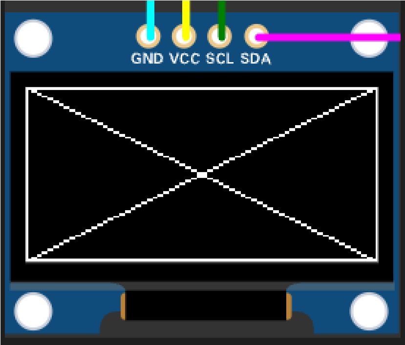

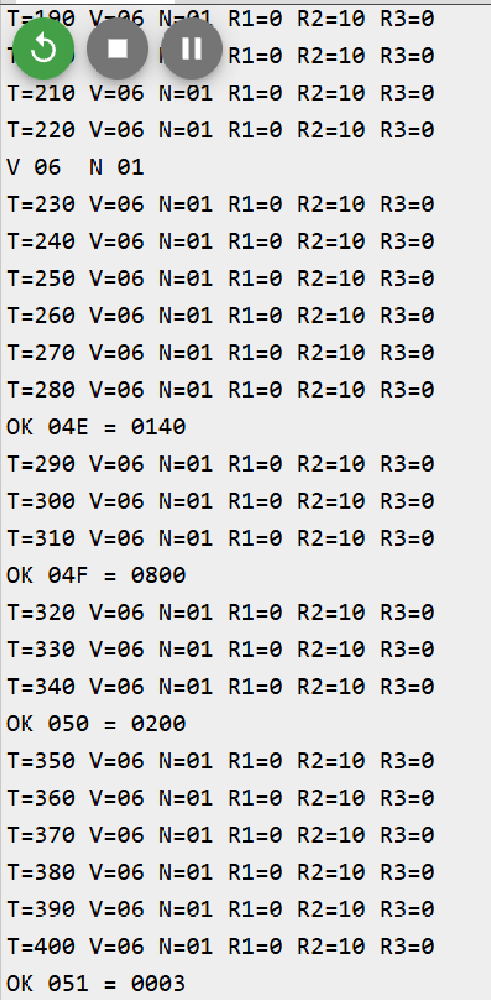

#### Prueba 2: Modo robo de ciclo (cycle stealing)

En este modo, el DMA "roba" turnos al bus de forma alternada: usa un ciclo, le deja el siguiente a la CPU, y así sucesivamente. Usamos los mismos comandos de configuración y cambiamos solo el de arranque:

```
V36
V35
W04E,0140
W04F,0800
W050,0200
W051,0001   <- arranca el DMA en modo robo de ciclo (el bit 1 está apagado)
```

**Resultado:** la imagen se fue dibujando lentamente, de arriba hacia abajo, en la pantalla OLED. Al usar el comando `V06N22` durante el proceso, vimos cómo bajaba el contador de palabras que faltaban. El reporte `D` confirmó que la CPU usó aproximadamente 512 turnos mientras el DMA trabajaba, lo que comprueba que ambos se turnan el bus.

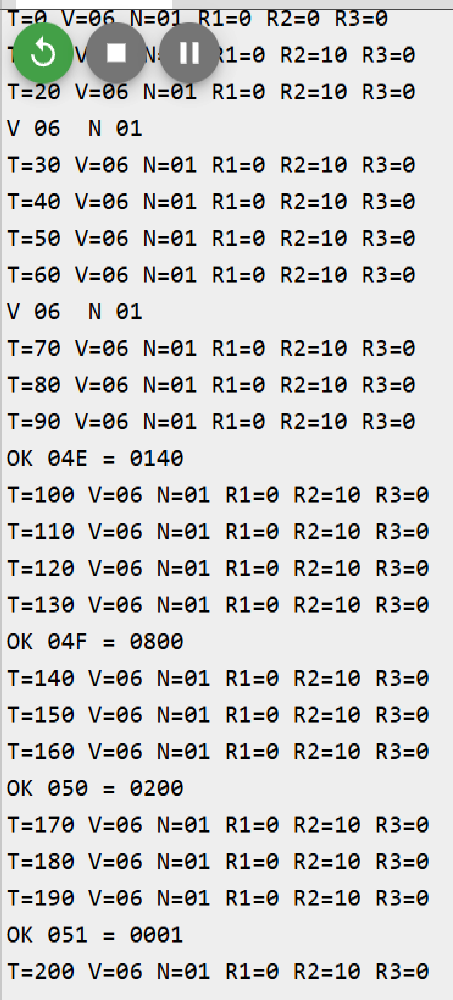

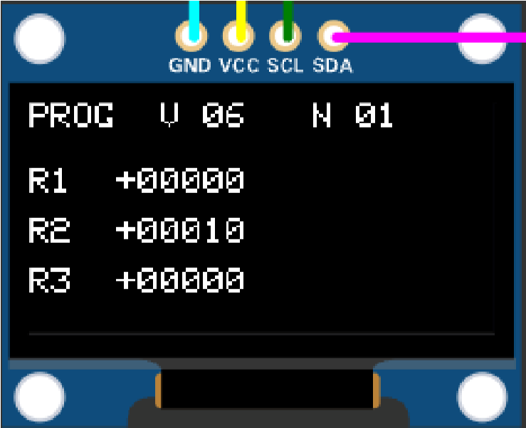

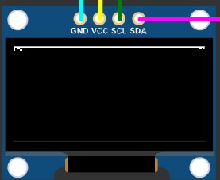

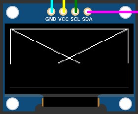

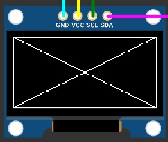

#### Prueba 3: Rómpelo a propósito (protección de la ROM)

Para probar que el sistema tiene protecciones, intentamos copiar datos a una dirección prohibida: la ROM, donde vive el programa base. Estos fueron los comandos:

- `W04F,0100`: cambia el destino a 0x100, que es la dirección de la ROM.
- `W051,0001`: arranca el DMA.
- `D`: pide el reporte de estado.

**Resultado:** el Monitor Serie mostró `estado=3` (error). La función `escribirMem` detectó el intento de escribir en la ROM, activó una bandera de alarma (`alarmaMem`) y detuvo el DMA automáticamente. Esto demuestra que la memoria del programa está protegida contra escrituras por error.

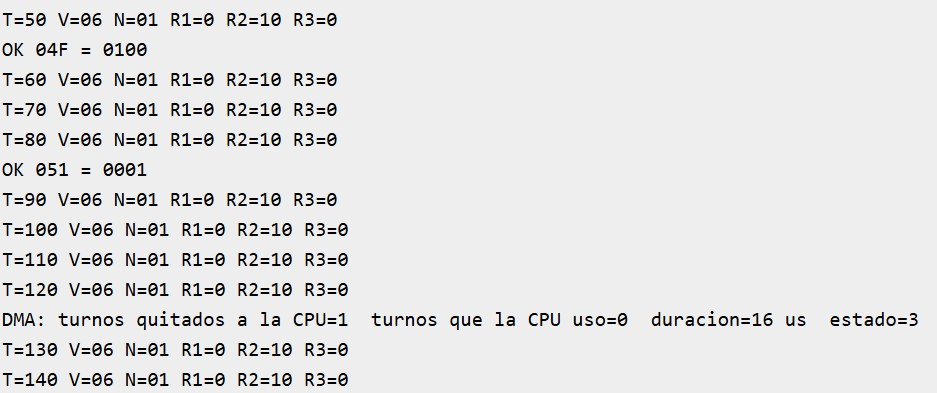

## Midió

### Paso 5: Ancho de banda de la pantalla

Medimos cuánto tarda la Tarea 3 (la que actualiza la pantalla) en dibujar los 1024 bytes de la imagen. Después forzamos un refresco cada 30 ms (comando `T10`) para ver cómo reaccionaba el sistema.

Tabla de ancho de banda (cuántos datos por segundo llegan a la pantalla):

| Medida | Valor |
|---|---|
| Tiempo de un refresco (tarea 3) | 39,197 µs (39.197 ms) |
| Ancho de banda real = 1,024 bytes ÷ 0.039197 s | 26,124 bytes/s |
| Cuadros por segundo máximos = 1 ÷ 0.039197 s | 25.5 fps |
| Tiempo teórico calculado para I2C a 400 kHz | 23,040 µs |

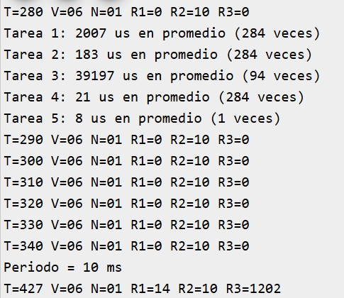

Al forzar el refresco con `T10`, la cola de tareas se saturó: el registro R1 (que muestra el tamaño de la cola) subió hasta 269 y se activó la alarma 1202 (R3=1202), igual que le pasó al Apollo 11.

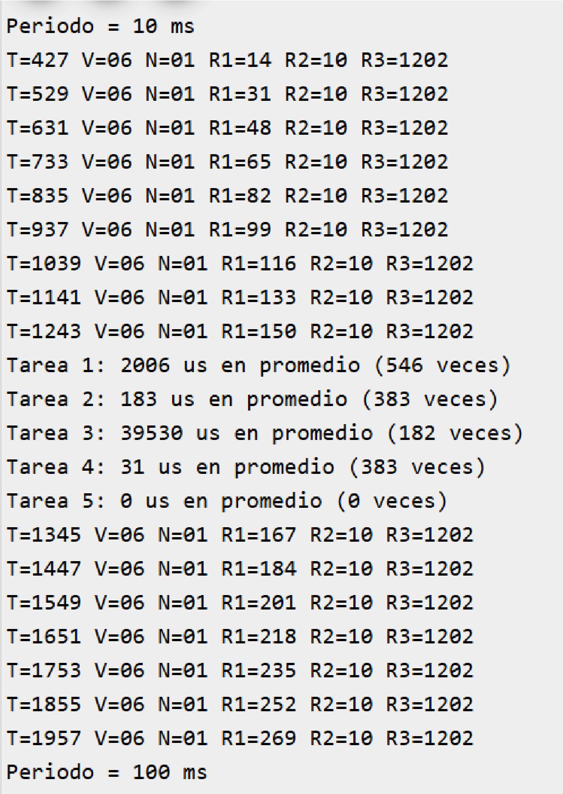

## Argumentó

### ¿Por qué ampliaste IO_TAM a 32 y no a 19, que alcanzaba?

Porque en el diseño de hardware conviene organizar la memoria en bloques cuyo tamaño sea una potencia de 2 (8, 16, 32, 64). Con 32, el bloque de Entrada/Salida termina en una dirección "redonda" en hexadecimal (0x05F) y no se encima con el inicio de la ROM (0x100). Así, el circuito que decide a qué zona de memoria corresponde cada dirección es mucho más sencillo.

### Para llenar la pantalla copiando 512 palabras con tu ISA (que usa CA y TS), ¿cuántas instrucciones serían? ¿Qué le falta a tu ISA?

Serían 1024 instrucciones, porque cada palabra de 16 bits necesita dos: una para cargarla y otra para guardarla. Eso no cabe en nuestra memoria ROM. A nuestro conjunto de instrucciones (ISA) le falta una forma de "apuntar" a una dirección con un puntero (direccionamiento indirecto) o una instrucción que copie bloques completos, para no tener que escribir una carga y un guardado por cada palabra.

### Afirmación a verificar: "Si refresco más seguido, la imagen se ve más fluida."

**Falso en este caso.** Con `T10` (refresco cada 30 ms) le pedimos a la computadora más cuadros de los que el hardware puede dar, porque cada refresco tarda casi 40 ms. En nuestra captura se ve que la cola de tareas se saturó (R1 subió hasta 269) y se activó la alarma 1202 (R3=1202). La imagen no se volvió más fluida porque el límite está en el bus I2C, que es el camino lento hacia la pantalla, y no en la CPU.

### ¿Cómo evitarías el desgarro (tearing) usando dos arreglos de VRAM y un registro en IOREG?

Usaría **doble búfer** (*double buffering*): tendría dos copias de la memoria de video, `VRAM_A` y `VRAM_B`. Mientras el DMA llena `VRAM_A`, la pantalla muestra `VRAM_B`. Cuando el DMA termina, un registro en IOREG (por ejemplo, `IO_BUFFER_ACTIVO`) cambia de golpe cuál de las dos se usa. Así, la pantalla nunca muestra una imagen a medio dibujar y desaparece el desgarro, que es cuando se ven partes de dos imágenes a la vez.

### Uso de la IA

Se utilizó la ayuda de la inteligencia artificial para comprender de una manera más fácil y sencilla los términos que no logré comprender del laboratorio.
