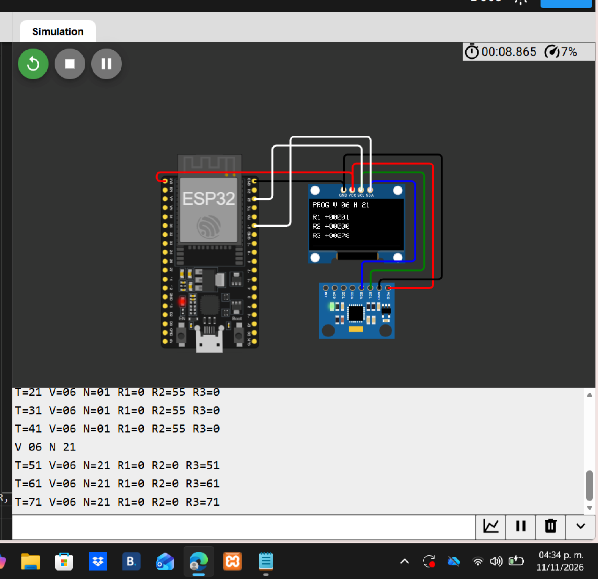
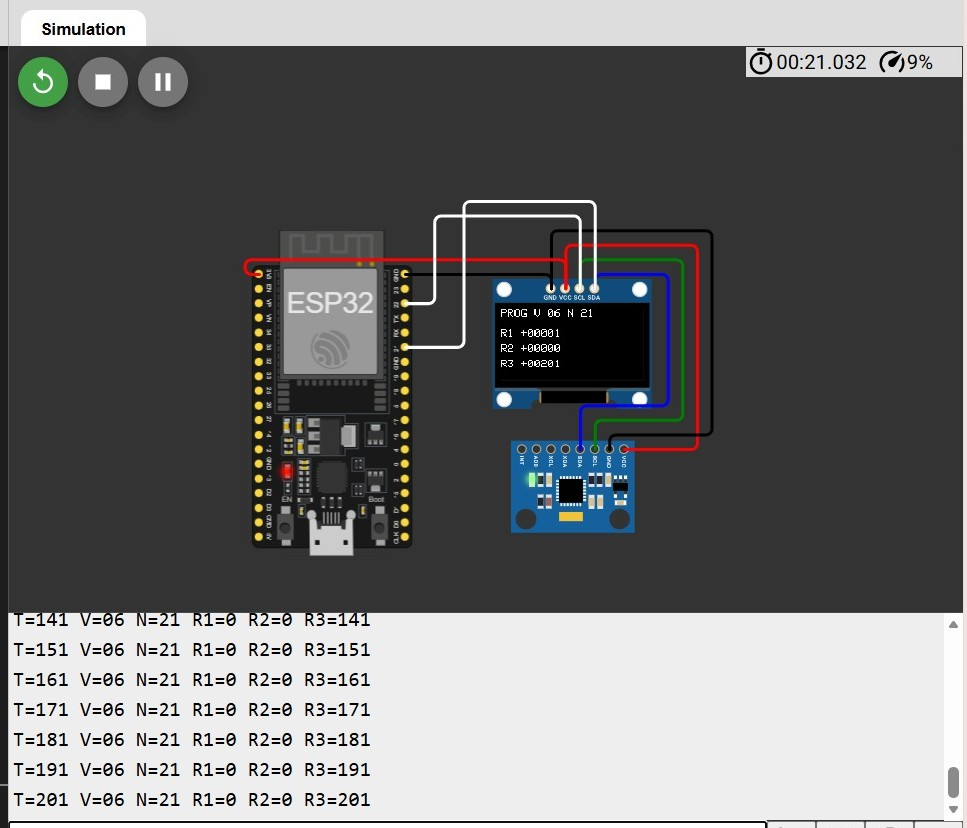
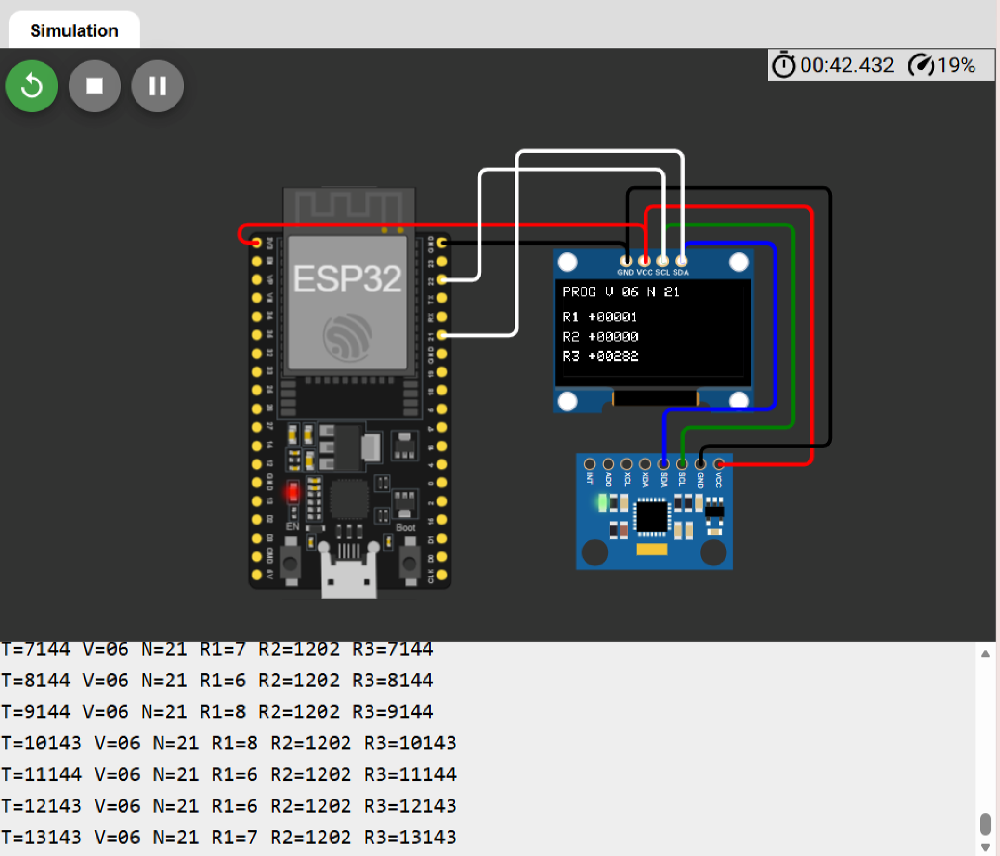
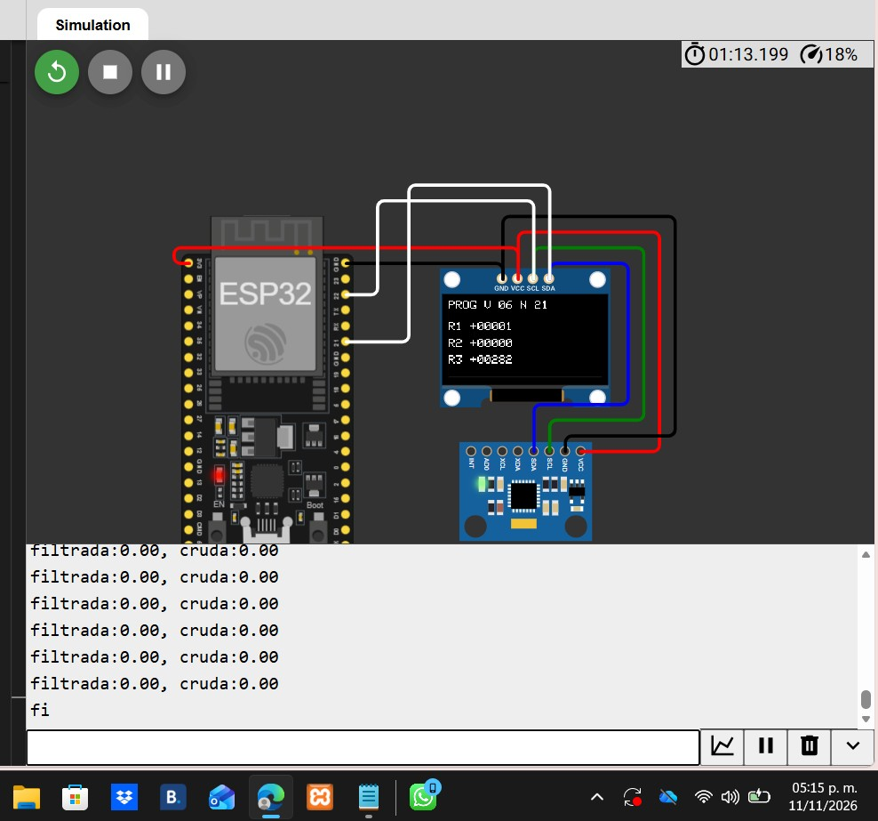
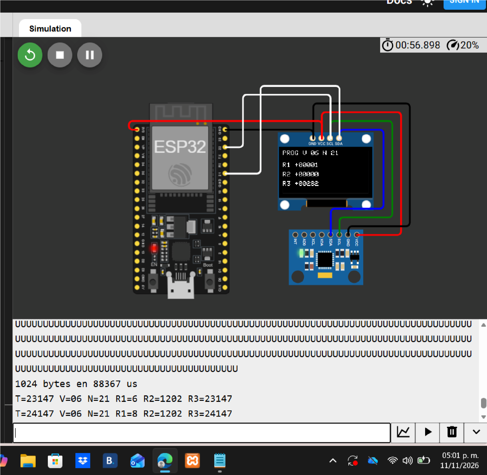
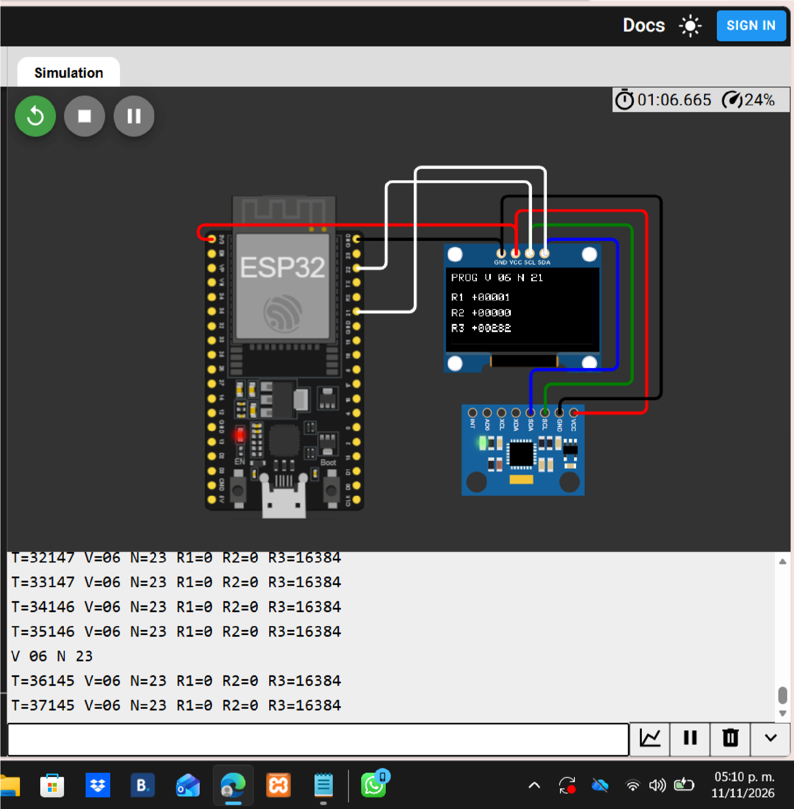

# AGC 5 – Interconexión y adquisición (Laboratorio 10)

**Caso guía.** Durante las misiones Apolo, el AGC no trabajaba por sí solo. Para que la nave pudiera orientarse y comunicarse correctamente, necesitaba recibir información de otros equipos. Entre los más importantes estaban:

- **El sistema de comunicación con el Centro de Control de Misión en Houston:** por este medio se enviaban datos de la nave y se recibían instrucciones. La conexión tenía una velocidad limitada, por lo que no era posible enviar grandes cantidades de información, como video o imágenes completas. En su lugar, la computadora transmitía datos breves, como valores de sensores, estados internos y avisos de error.
- **Los sensores de movimiento y orientación:** estos dispositivos medían la aceleración y los giros de la nave. Al principio, sus señales eran valores eléctricos que después se convertían en números. El programa del AGC utilizaba esos datos, hacía los ajustes necesarios y calculaba la posición y orientación del Módulo Lunar o del Módulo de Mando y Servicio.

**Qué se hace.** En este laboratorio se recrea una versión sencilla de ese funcionamiento. Se establece una comunicación por cable serie entre el ESP32 y la computadora, que representa al Centro de Control de Houston. También se utiliza un sensor de movimiento simulado para convertir sus lecturas en datos que puedan interpretarse. Todas las pruebas se realizaron en el simulador en línea Wokwi.

## Funciona

### Circuito virtual

- **Microcontrolador ESP32:** seleccionado por su procesamiento de doble núcleo a 240 MHz, su amplio soporte para interrupciones de hardware y la disponibilidad de buses de comunicación I2C y UART de alta velocidad.
- **Pantalla OLED SSD1306:** conectada por el bus I2C estándar, a una frecuencia de reloj de 400 kHz para tener tasas de refresco fluidas sin bloquear el ciclo principal de la CPU.
- **Sensor inercial MPU6050:** emulado en el entorno, configurado para responder por I2C en la dirección hexadecimal 0x68.
- **Botón pulsador externo (ENTR):** conectado al pin GPIO 32 con resistencia pull-up interna, configurado para generar interrupciones por flanco de bajada. Emula la tecla de entrada y reconocimiento de datos del DSKY original.

**Aspectos a tomar en cuenta en el simulador:**

- La comunicación serie de Wokwi no funciona exactamente igual que una conexión física. Por eso, los tiempos medidos con el comando `B` pueden cambiar un poco según el navegador y la computadora.
- El MPU6050 del simulador no presenta el ruido eléctrico ni las vibraciones de un sensor real. Sus valores se modifican con controles en pantalla, así que las mediciones de ruido en reposo pueden aparecer en cero. Ese resultado corresponde al simulador y no necesariamente a un sensor físico.
- La velocidad de la simulación depende del equipo donde se ejecuta el navegador. Los tiempos del temporizador representan el funcionamiento esperado del programa, aunque pueden variar ligeramente.

### Estructura del programa base del AGC

El programa que se ejecuta en el ESP32 reúne lo trabajado en las prácticas anteriores. Está organizado en siete partes principales:

1. **Tipos de datos y ancla de sesión.** Se define `palabra_t` (un entero de 16 bits) y la estructura `CPU`, que guarda la información principal del procesador:
   - **PC (Program Counter):** dirección de la siguiente instrucción a ejecutar en la ROM.
   - **A (Accumulator):** registro acumulador principal para operaciones aritméticas y lógicas.
   - **Q:** dirección de retorno para saltos con almacenamiento de enlace.
   - **IR (Instruction Register):** código de la instrucción en ejecución.
   - **detenida:** bandera que indica el cese de operaciones por HALT o error crítico.
   - **ciclos:** contador acumulativo de ciclos de instrucción ejecutados.

   También se incluye `imprimirAncla()`, que obtiene un identificador del ESP32, lo combina con un valor aleatorio y muestra una marca de sesión en el Monitor Serie cada vez que inicia la simulación.
2. **Mapa de memoria y programa.** La memoria del AGC simulado tiene tres zonas:
   - **RAM:** 64 espacios para datos, de 0x000 a 0x03F.
   - **Registros de entrada y salida:** 16 posiciones, de 0x040 a 0x04F. Aquí se guardan datos de los sensores, botones, temporizador y alarmas.
   - **ROM:** 64 espacios para las instrucciones del programa, de 0x100 a 0x13F.
3. **CPU y ejecución de instrucciones.** La función `decodificar()` separa cada instrucción de 16 bits en el **opcode** (los 4 bits más significativos) y la **dirección de operando** (los 12 bits menos significativos). La función `cpuPaso()` realiza el ciclo en tres etapas: **FETCH** (busca la siguiente instrucción), **DECODE** (identifica la operación y la dirección) y **EXECUTE** (realiza la operación). El programa contempla ocho instrucciones básicas, como sumar, restar, guardar datos, hacer saltos y detener la CPU.
4. **Sensor MPU6050.** Se comunica con el sensor por I2C: primero lo activa y después solicita sus lecturas, que se guardan en los registros correspondientes.
5. **Interrupciones y lista de tareas.** Un temporizador genera una señal cada 100 ms. En lugar de hacer todo el trabajo dentro de esa señal, el programa agrega las tareas a una lista circular y el ciclo principal las atiende una por una, para que las interrupciones no hagan operaciones demasiado largas. Si llegan más tareas de las que se pueden atender y la lista se llena, se activa la **alarma 1202**, el mismo tipo de problema que se presentó en la computadora del Apollo 11.
6. **Pantalla DSKY y comunicación serie.** Controla lo que aparece en la OLED y recibe las instrucciones del Monitor Serie. `registrosDelSustantivo()` define qué variables se muestran en los tres registros del DSKY según el sustantivo activo, y `atenderSerie()` interpreta los comandos de control en tiempo real.
7. **Tareas y recuperación.** El programa principal toma las tareas pendientes y las ejecuta. Si aparece la alarma 1202, `recuperar1202()` limpia la lista de espera y reinicia el estado de la CPU, procurando conservar los datos de la RAM.

### Comunicación con la computadora: enlace serie

Para representar la comunicación entre la nave y Houston, el programa envía cada segundo una línea breve con información del AGC. En lugar de mandar una imagen completa de la pantalla, transmite únicamente los datos necesarios para conocer el estado del sistema.

### Comprobación con el comando V

Para verificar la operación bidireccional del canal, se ejecutó el cambio de visualización enviando el comando de cambio de sustantivo al DSKY.



### Comprobación del comando W

El protocolo de control incluye el comando `W<dir>,<val>` en la función `atenderSerie()`, que permite modificar celdas de la RAM o registros de E/S desde la PC mientras el programa corre.

- **Comando enviado:** `W000,0100`.
- **Significado:** escribir el valor hexadecimal 0100 en la dirección de RAM 0x000.
- **Resultado observado:** el AGC procesó la cadena, localizó la celda y devolvió la confirmación `OK 000 = 0100`. La celda RAM[0] almacena un puntero de dirección que el DSKY usa para decidir qué dato proyectar en el Registro 1. Al cambiar su contenido de 0x0020 a 0x0100, el sistema redirigió su visualización hacia el código de la primera instrucción ejecutable del programa de suma (0x100B). Al introducir después `V01N01`, el sistema interpretó la celda y mostró el valor octal de esa instrucción (010013), equivalente al decimal 4107 en la telemetría del puerto serie.



### Simulación de la alarma 1202 y acuse de recibo

Durante las misiones lunares reales, la sobrecarga repentina de tareas en el AGC provocaba la célebre alarma 1202, donde el computador descartaba tareas de baja prioridad para salvar la guía de aterrizaje. En nuestra simulación, al forzar una frecuencia de muestreo extrema con el comando `T1`, el volumen de eventos colapsó la cola circular. Esto activó el indicador de advertencia PROG en la pantalla OLED y registró el código 1202 en el registro `IO_ALARMA`.



Para reducir la contingencia se restableció el periodo nominal con `T100` (100 ms), y el mecanismo `recuperar1202()` vació la cola y reinició la CPU sin perder los resultados en memoria. Sin embargo, el indicador de alarma en el DSKY requería un acuse de recibo explícito, que se logró con la escritura directa:

```
W04A,0000
```

La dirección 0x04A corresponde al registro de alarma (`IO_ALARMA`). El sistema respondió `OK 04A = 0000`, limpió el código de error y apagó el indicador PROG en el OLED, simulando el reconocimiento de una alerta crítica.

### Registro IO_INCL y sustantivo 23 del DSKY

Para mostrar la inclinación al operador se añadió el registro de E/S número 13 y se configuró el sustantivo 23 (N=23). Con el comando `V06N23`, la rutina `registrosDelSustantivo()` muestra:

- **R1:** el ángulo de inclinación filtrado, en centésimas de grado.
- **R2:** el valor crudo del acelerómetro en el eje Y.
- **R3:** el valor crudo del acelerómetro en el eje Z.

### Filtro de promedio móvil (F1, F8 y F64)

El filtro suaviza los cambios pequeños en las lecturas del sensor: guarda varias mediciones recientes y calcula su promedio. La lectura se ve más estable, pero puede tardar más en reflejar un cambio rápido. El programa guarda las últimas lecturas en una lista circular de hasta 64 valores (`FILTRO_MAX 64`); cada lectura nueva se agrega y se calcula el promedio de los valores disponibles. El tamaño se cambia desde el Monitor Serie:

- **`F1`:** una sola lectura, prácticamente sin suavizado.
- **`F8`:** promedio de las últimas ocho lecturas.
- **`F64`:** promedio de las últimas 64 lecturas; la lectura es más suave pero con mayor retraso.

### Modo de medición (comando V27)

El comando `V27` activa un modo que envía continuamente las lecturas del sensor, lo que permite comparar los valores originales con los filtrados mediante una gráfica.



## Midió

### Ancho de banda del enlace serie (comando B)

Para medir la capacidad del enlace se programó el comando `B`, que ordena al ESP32 transmitir un bloque de exactamente 1,024 bytes del carácter ASCII `U` (0x55) y mide el tiempo transcurrido con `micros()`. Se ejecutó tres veces desde el Monitor Serie de Wokwi:

| Medición | Tiempo |
|---|---|
| 1 | 88,366 µs (88.366 ms) |
| 2 | 88,366 µs (88.366 ms) |
| 3 | 88,364 µs (88.364 ms) |
| **Mediana** | **88,366 µs (0.088366 s)** |



### Pantallas por segundo que cabrían en el enlace

| Concepto | Valor |
|---|---|
| Tamaño de un cuadro de la OLED (128 × 64 bits) | 1,024 bytes |
| Caudal requerido a 60 cuadros/s (1,024 × 60) | 61,440 bytes/s |
| Capacidad del enlace UART a 115,200 baudios 8N1 | 11,520 bytes/s |
| Factor de saturación (61,440 ÷ 11,520) | 5.33 veces |
| Cuadros por segundo que sí caben (11,520 ÷ 1,024) | 11.25 |

### Pruebas de inclinación

Con los controles del MPU6050 en Wokwi se probaron tres posiciones:

| Posición | Esperado | R1 | R2 | R3 |
|---|---|---|---|---|
| Plana (Y = 0 g, Z = 1 g) | Ángulo 0 | 0 | 0 | 16384 |
| +90° (Y = 1 g, Z = 0 g) | +90° | 9000 | 16384 | 0 |
| −90° (Y = −1 g, Z = 0 g) | −90° | −9000 | −16384 | 0 |

En posición plana, el valor de 16,384 en Z confirma la sensibilidad de la hoja de datos (16,384 LSB/g en la escala de ±2 g).



### Resolución del sensor

El cambio de un solo LSB cerca de 0 equivale a un cambio angular de:

$$\Delta\theta_{rad} = \frac{1}{16384} \approx 0.000061035\ \text{radianes}$$

$$\Delta\theta_{deg} = 0.000061035 \times \frac{180}{\pi} \approx 0.003496^\circ \approx 0.0035^\circ \text{ por LSB}$$

### Frecuencia de lectura

El temporizador solicita una lectura cada 100 ms, es decir, 10 lecturas por segundo (10 Hz). Al registrar series de 100 marcas de tiempo consecutivas en el Monitor Serie, las muestras llegaron de forma regular cada 100 ms: de t = 10393 ms a t = 20393 ms pasaron exactamente 10 segundos para 100 muestras. Esto confirma una tasa sostenida de 10 Hz sin pérdida de datos ni retrasos en la cola de tareas.

### Ruido en reposo

Con el MPU6050 en posición plana (Y = 0 g, Z = 1 g), se activó el modo `V27` y se recolectaron lotes de 100 líneas consecutivas para cada filtro. Después se calculó el promedio y la desviación estándar en una hoja de cálculo.

| Filtro | Promedio | Desviación estándar | Datos |
|---|---|---|---|
| F1 | 0.0000 | 0.0000 | 100 |
| F8 | 0.0000 | 0.0000 | 100 |
| F64 | 0.0000 | 0.0000 | 100 |

### Tiempo de respuesta de los filtros

Se cambió rápidamente la inclinación del sensor desde el control de Wokwi y se comparó el momento en que cambiaba la lectura original con el momento en que la lectura filtrada alcanzaba el nuevo valor.

| Filtro | Retardo en muestras | Retardo en tiempo (a 10 Hz) | Comportamiento |
|---|---|---|---|
| F1 (sin filtro) | 1 | 0.1 s | La lectura filtrada sigue prácticamente el mismo cambio que la original. |
| F8 | 8 | 0.8 s | La lectura cambia de manera más gradual y tarda más en llegar al nuevo valor. |
| F64 | ≈ 64 | ≈ 6.4 s | La curva filtrada tarda más de seis segundos en reflejar el cambio real. |

### Prueba de esfuerzo (comando T10)

Con el filtro F64 activo se envió `T10`, con lo que el temporizador pasó de pedir una lectura cada 100 ms a pedirla cada 10 ms, diez veces más rápido. Con 64 muestras a 10 ms por muestra, el retardo teórico del filtro bajaría a unos 0.64 s. Al consultar el DSKY con `V06N21`, la cola de tareas (R1) alcanzó su capacidad máxima (8) y el registro de alarma (R2) se disparó al código 1202. Al volver a `T100`, la cola se vació y el sistema se recuperó automáticamente.

## Argumentó

### ¿Qué significa 115200 8N1? ¿Cuántos bits viajan por byte?

La configuración 115200 8N1 indica cómo se envían los datos por una conexión serie: 115200 es la velocidad en bits por segundo, el 8 indica que cada dato tiene ocho bits, la N significa que no se usa bit de paridad y el 1 señala un bit de parada. Además de los 8 bits de datos, cada byte necesita un bit de inicio y uno de paro, así que viajan **10 bits por byte** (1 de inicio + 8 de datos + 1 de paro).

Como cada byte ocupa 10 bits, la capacidad del enlace es 115,200 ÷ 10 = **11,520 bytes por segundo**.

### Sensibilidad del acelerómetro del MPU6050 en ±2 g

El acelerómetro del MPU6050 digitaliza la aceleración con convertidores analógico-digitales de 16 bits con signo. En la escala de ±2 g, **1 g equivale a 16,384 LSB**. Por eso, con la placa en reposo y la gravedad incidiendo sobre un eje, el registro de ese eje entrega un valor muy cercano a 16,384. En escalas mayores la sensibilidad se reduce a la mitad sucesivamente: se gana rango de medición a costa de perder resolución.

### ¿Se pueden transmitir 60 pantallas por segundo por este enlace?

**No, la afirmación es falsa.** Una pantalla OLED de 128 × 64 bits son 1,024 bytes por cuadro; a 60 cuadros por segundo harían falta 61,440 bytes/s, pero el enlace UART a 115,200 baudios 8N1 solo da 11,520 bytes/s. El déficit es de 5.33 veces: el enlace solo sostiene unas 11 actualizaciones de pantalla por segundo (11,520 ÷ 1,024 = 11.25). Por eso el AGC real y nuestra telemetría transmiten tramas de texto de estado compacto (~40 bytes) en lugar de flujos gráficos: el ancho de banda se reserva para las variables críticas de navegación y control.

### ¿Cómo se convierte la lectura del MPU6050 en un ángulo?

Con el dispositivo estático, la aceleración medida representa la dirección y magnitud de la gravedad. Según la inclinación de la placa, esa fuerza se reparte entre los ejes Y y Z. 

Cerca de la horizontal, el ángulo se puede aproximar para ángulos pequeños en radianes como:

$$\theta \approx \frac{Y}{Z}$$

Con Z constante en 1 g = 16,384 LSB, un cambio de 1 LSB en Y produce el cambio angular calculado en la sección de resolución (≈ 0.0035° por LSB).

### ¿Por qué la desviación estándar salió en cero?

En las tres pruebas (F1, F8 y F64) la desviación estándar fue cero porque el sensor simulado no genera las pequeñas variaciones eléctricas de un sensor físico. Wokwi es una abstracción matemática idealizada, sin ruido térmico ni fluctuaciones analógicas de voltaje, así que el filtro no tuvo ruido real que eliminar. En un dispositivo real, el promedio de varias lecturas normalmente reduce las variaciones, aunque el efecto depende de la cantidad de datos usados.

### ¿Qué demuestra la prueba T10 con el filtro F64?

La CPU del ESP32 fue incapaz de procesar la avalancha de lecturas del sensor combinada con el cálculo del filtro de 64 elementos a 100 Hz: la cola se llenó y se disparó la alarma 1202. Al volver a `T100`, el sistema se recuperó solo. Esto comprueba un principio de los sistemas embebidos de tiempo real: el procesamiento que se puede hacer está limitado por la capacidad del hardware disponible.

### Declaración sobre el uso de la inteligencia artificial

Este laboratorio fue realizado con la ayuda de la inteligencia artificial Claude, que me ayudó a comprender de una manera más fácil y sencilla, y también a realizar las fórmulas matemáticas que aquí se presentan.
